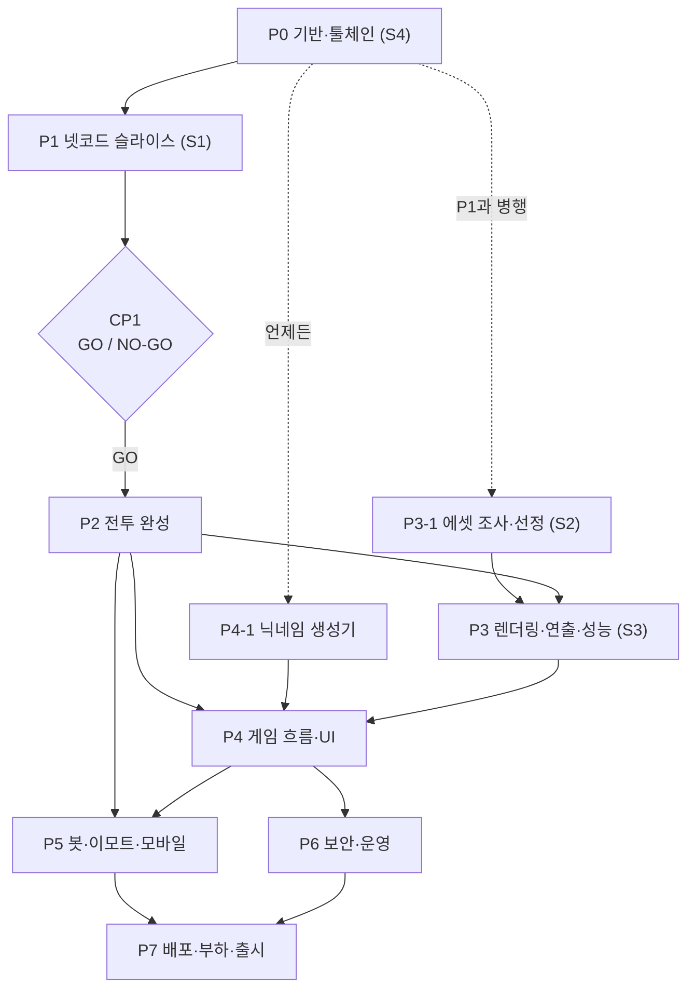

# 🥊 Fight Club — 구현 워크플로

> `/sc:workflow` 결과 · 작성일 2026-10-30 · 상태: v0.1
> 근거: [requirements.md](../docs/requirements.md) · [design.md](../docs/design.md)
> 전제: 이번 실행을 설계 승인으로 간주한다 (design §2 핵심 결정, §12 기존 코드 변경 포함). 호스팅은 기본안(서울 리전 VM)으로 두고 P7-1에서 확정한다.
> 다음 단계: `/sc:implement`로 P0부터 순서대로 진행

---

## 0. 한눈에 보기

### 원칙
1. **리스크 먼저**: 가장 불확실한 넷코드(R1)를 상자 캐릭터로 먼저 검증하고, 그 위에 콘텐츠를 얹는다.
2. **시뮬레이션은 테스트 먼저**: 클라이언트와 서버가 같은 shared 코드를 쓰므로 한 곳의 버그가 양쪽에 퍼진다. 프레임 데이터·넉백·탈락 규칙은 테스트로 먼저 고정한다.
3. **병행할 수 있는 일은 일찍**: 에셋 조사(S2)와 닉네임 생성기는 다른 코드에 거의 의존하지 않으므로 P1과 함께 진행한다.
4. **단계마다 체크포인트**: 체크포인트를 통과해야 다음 단계로 넘어간다. 사용자 확인이 필요한 지점은 §4에 모아 두었다.

### 단계

| 단계 | 목표 | 체크포인트 | 규모 |
|---|---|---|---|
| P0 기반·툴체인 | 모노레포 구성, Colyseus가 TS 7에서 동작하는지 확인 (S4) | CP0 | S~M |
| P1 넷코드 슬라이스 | 상자 캐릭터 + 잽 1종으로 예측·보간·랙 보상 체감 검증 (S1) | CP1 (GO/NO-GO) | L |
| P2 전투 완성 | 공격 5종·가드·잡기·넉백·탈락 규칙 전부 + 테스트 | CP2 | L |
| P3 에셋·렌더링 | 실제 캐릭터·애니메이션·연출·사운드, 모바일 성능 확인 (S2·S3) | CP3 | L |
| P4 게임 흐름·UI | 닉네임, 입장 처리, 화면 흐름, HUD | CP4 | L |
| P5 봇·이모트·모바일 | 남은 MVP 기능 | CP5 | L |
| P6 보안·운영 | 남용 방지, 악용 차단, 관측 | CP6 | M |
| P7 배포·출시 | 배포, 부하 테스트, 플레이테스트, 출시 점검 | CP7 | M |

규모: S < M < L. L 작업은 `/sc:implement`를 여러 번에 나눠 진행하는 것을 권장한다.

### 마일스톤

| 마일스톤 | 시점 | 확인할 수 있는 것 |
|---|---|---|
| M1 넷코드 검증 | CP1 | 상자 2개가 잽으로 싸움, 지연 150ms에서 체감 확인 |
| M2 전투 완성 | CP2 | 상자로 모든 동작 (공격 5종 · 가드 · 잡기 · 낙사) |
| M3 첫 플레이어블 | CP3 + CP4 | 실제 캐릭터로 시작 → 전투 → 결과 전체 흐름 |
| M4 기능 완성 | CP5 | 봇 · 이모트 · 모바일 |
| M5 출시 | CP7 | 배포 · 부하 테스트 · 플레이테스트 완료 |

---

## 1. 실행 순서와 의존 관계

- **주 경로**: P0 → P1 → P2 → P3 → P4 → P5 → P7.
- **곁가지**: P3-1(에셋 조사)과 P4-1(닉네임 생성기)은 P0 직후부터 끼워 넣을 수 있다. P6은 P5와 병행할 수 있다.

---

## 2. 단계별 작업

표의 "근거"는 design.md의 절 번호와 요구사항 ID다.

### P0 — 기반 정리·툴체인 검증 (S4) — ✅ 완료 (2026-10-30)
목표: 모노레포가 빌드·실행·테스트되고, Colyseus가 TS 7 환경에서 동작함을 확인한다.
결과: TS 7은 typescript-eslint와 호환되지 않아 TS 6.0.3으로 진행했다. Colyseus 0.18은 정상 동작한다 (design §14).

| ID | 작업 | 완료 기준 | 선행 | 근거 | 규모 |
|---|---|---|---|---|---|
| P0-1 | git 저장소 초기화, 현재 템플릿 상태로 첫 커밋 (**사용자 확인 후**) | `git log`에 첫 커밋 | — | 파일 이동 전에 되돌릴 지점 확보 | S |
| P0-2 | npm workspaces 전환, 템플릿을 `client/`로 이동, 이름·`lang="ko"`·제목 정리, 예제 파일 삭제 | `client` 개발 서버에서 빈 화면이 뜸 | P0-1 | §12 | S |
| P0-3 | `shared` 패키지 골격 (기존 tsconfig 규칙 동일 적용) | client와 server 양쪽에서 shared 상수를 import해도 빌드 통과 | P0-2 | §3.2 | S |
| P0-4 | `server` 패키지 골격: Colyseus 서버, 빈 ArenaRoom(`defineTypes` Schema, `tick` 필드), `/healthz`, `tsx watch` | 서버 기동, `/healthz` 200 | P0-3 | §6, S4 | M |
| P0-5 | 루트 스크립트(`dev`·`build`·`typecheck`·`lint`·`test`)와 Vitest 설정 | 각 스크립트 실행 성공 | P0-4 | §9 | S |
| P0-6 | S4 연결 확인: 클라이언트가 방에 들어가 `tick`을 화면에 표시 | 브라우저에 증가하는 tick이 보이고, 클래스 필드 초기화가 Schema 필드를 덮어쓰지 않음 | P0-5 | §11 S4 | S |

**CP0 검증**
- `npm run typecheck && npm run lint && npm test && npm run build` 통과.
- 브라우저 탭 두 개가 같은 방에 들어가 같은 tick을 표시.
- **실패 시**: (1) server만 TS 버전을 낮춤 → (2) Schema 정의 방식 변경 → (3) 그래도 안 되면 ADR-02 재검토(`ws` 직접 구현). (3)은 사용자와 결정한다.

### P1 — 넷코드 수직 슬라이스 (S1) — 구현 완료, CP1 대기 (2026-10-30)
목표: 상자 캐릭터 두 개가 잽으로 싸우는 최소 게임으로 예측·보간·랙 보상을 검증한다.
> **착수 시 변경**: Colyseus 0.18의 내장 넷코드(고정 스텝·입력 버퍼·랙 보상·클라이언트 예측·지연 주입)를 쓰고, 게임 규칙만 직접 만들도록 작업을 다시 짰다 (design §14).

| ID | 작업 | 완료 기준 | 상태 | 규모 |
|---|---|---|---|---|
| P1-1 | shared 상수·Action·버튼 비트·잽 데이터, 입력·상태 Schema (`@colyseus/schema`) | 타입 검사 통과 | ✅ | S |
| P1-2 | shared `stepPlayer`: 걷기·달리기·점프·중력·착지·가장자리 낙하·바라보는 방향·잽·경직 (**테스트 먼저**) | 결정성, 점프 높이 1.2m ±2cm·체공 0.7초, 가장자리 밖 착지 불가, 잽 판정 5~7프레임, 넉백 0.4m ±5mm | ✅ 테스트 18개 | M |
| P1-3 | 서버 루프: `setFixedTimestep` + `defineInput` 소비, 입력 크레딧(속도 조작 방지), 6틱 무입력 시 빈 입력 진행, 임시 리스폰 | 통합 테스트: 입력대로 이동(지터 포함), 몰아 보내도 빨라지지 않음, 입력이 끊겨도 착지까지 진행 | ✅ | M |
| P1-4 | 클라이언트: 키보드(`code` 기준), `room.input` + `Reconciler`(내 캐릭터 예측), `Predict` lerp 100ms(원격 보간), 원격 동작 지연 재생 | 지연 0·150ms에서 걷는 동안 예측 보정 0cm | ✅ | L |
| P1-5 | R3F 테스트 씬: 경기장·가장자리 띠, 상자 캐릭터, 쿼터뷰 추적 카메라 | 스크린샷으로 확인 | ✅ | S |
| P1-6 | 잽 판정: `allowRewindState` + `lastSeenBy`로 되감기, 피해·고정 넉백·경직, `hit` 이벤트, 클라이언트 예측 스파크 | 통합 테스트 + 브라우저 점검: RTT 170ms·움직이는 상대에서 예측 명중 = 서버 확정 | ✅ | M |
| P1-7 | 개발 도구: 지연 주입 버튼(바꾸면 모든 탭 재접속), 디버그 오버레이(RTT·확인 대기 입력·예측 보정·명중 비교·서버 위치·잽 판정) | 0 / 150 / 300ms 전환 | ✅ (지터·손실 주입은 미지원). 연습용 샌드백(서 있음·왕복) 추가 | M |
| P1-8 | S1 플레이테스트: 탭 2~4개, 가능하면 다른 기기까지, 지연 0 / 150 / 300ms | CP1 기준별 결과 기록 | ⏳ **사용자 플레이 필요** | S |

**CP1 — GO/NO-GO (사용자가 직접 플레이)**
- 지연 150ms에서도 내 상자가 키 입력에 즉시 반응한다.
- 걷는 동안 보정 튐이 눈에 띄지 않는다 (오버레이의 보정 크기가 1cm 수준).
- 화면에서 맞힌 잽이 거의 다 인정된다 ("분명 맞았는데"가 없음).
- 맞은 상대가 밀려나는 모습이 늦게 느껴지지 않는다.
- **NO-GO일 때**: 보간 지연을 줄이거나 판정 반경을 넓혀 다시 시험한다. 그래도 안 되면 "공격자 클라이언트 판정 + 서버 검증" 방식(design §11 대안)으로 바꾸고 설계서를 갱신한다.

### P2 — 전투 시스템 완성 (상자 버전)
목표: 요구사항의 전투 규칙을 shared와 server에 모두 구현하고 테스트로 고정한다.

| ID | 작업 | 완료 기준 | 선행 | 근거 | 규모 |
|---|---|---|---|---|---|
| P2-1 | ✅ 나머지 공격: 스트레이트·발차기·돌진·날아차기·공중 펀치, 선입력 6프레임, 키 우선순위, 다중 명중과 대상당 1회 제한 | 공격마다 프레임 데이터 표대로 판정 프레임이 시작됨 (테스트) | CP1 | §4.4 | M |
| P2-2 | ✅ 가드: 누르는 동안 정지, 정면 140°, 피해 ×0.2·넉백 ×0.3, 가드 경직, 서버 판정(되감은 시점 또는 현재) | 정면·옆·뒤 공격 테스트 | P2-1 | §4.5, §4.6, §5.6 | M |
| P2-3 | ✅ 잡기·던지기: 잡기 시도 → 잡는 중 → 던지기 / 잡힘 → 던져짐, 방향 입력·0.6초 자동 던지기, 끊김 규칙, 동시 잡기 헛잡기, 가드 무시 | 상태 전이 테스트 전부 통과 | P2-2 | §4.7 | L |
| P2-4 | ✅ 경직·다운·무적: 공격별 경직, 연속 4번째 피격 → 다운 → 기상 무적, 무적 중 공격 시 해제 | 4번째 피격에서 다운 테스트 | P2-1 | §4.6, §4.8 | M |
| P2-5 | ✅ 조준 보정 (viewTick 시점 위치 기준) | 클라이언트 예측과 서버 결과가 같음 (테스트) | P2-1 | §4.5 | S |
| P2-6 | ✅ 몸끼리 부딪힘 (2026-11-02 앞당겨 완료): 움직이는 쪽이 막히고 클라이언트도 예측, 경기장 밖으로는 밀지 않음 | 통과 불가·미끄러짐·가장자리 테스트, 브라우저 점검 보정 0cm | P2-1 | §4.3 | S |
| P2-7 | ✅ 탈락·킬 인정: KO(60프레임), ringout(5초 규칙), selfout, AFK(60초), 30m 범위, 연결 끊김, `elim`·`result`, 4001 종료 | 통합 테스트: 원인별 결과 메시지와 제거 | P2-4 | §4.9, §5.7 | M |
| P2-8 | ✅ 스폰: 후보 12곳 중 다른 플레이어와 가장 먼 곳, 3초 무적 | 테스트 | P1-3 | §6.4 | S |
| P2-9 | ✅ 상자 버전 2~4인 플레이 점검 (지연 150ms) — 2026-11-02 사용자 점검 완료 | 모든 동작을 쓸 수 있고 상성표(§4.8)대로 동작 | P2-1~8 | §4.8 | S |

**CP2 검증**: 전투 규칙 테스트 전부 통과 + 상자 버전 플레이 점검 통과 → **M2 전투 완성**

**P2 진행 기록 (2026-11-02)**: P2-1~8 구현 완료. 테스트 71개(shared 47 · server 24) 통과 — 조준 보정은 서버가 돈 방향이 클라이언트 예측과 비트 단위로 같음을 통합 테스트로 확인. 브라우저 자동 점검(2인, 지연 0·150ms) 22항목 통과: 가드 스트레이트 피해 2·파란 스파크 예측, 잽 5, 잡기·던지기 10 → 다운 → 기상, 가장자리 발차기 낙사 킬 인정, 자멸, 결과 화면·다시 입장. 클라이언트는 상자 위에 팔다리·가드 방패(140° 호)·눕기·번쩍임·무적 깜빡임을 표시하고, 탈락하면 결과 화면을 띄운다 (캐릭터 선택은 P4). 2026-11-02 사용자가 플레이 점검(P2-9)을 마쳐 P2를 커밋했다.

### P3 — 에셋·렌더링 (S2, S3)
목표: 상자를 실제 캐릭터로 바꾸고 연출·사운드·품질 단계를 넣은 뒤 모바일 성능을 확인한다.

| ID | 작업 | 완료 기준 | 선행 | 근거 | 규모 |
|---|---|---|---|---|---|
| P3-1 | ✅ S2 에셋 조사·선정: 같은 뼈대를 쓰는 캐릭터 4~6종과 아래 애니메이션 목록, 라이선스 기록 (CC0 계열 우선) | 에셋·라이선스 표 작성, **아트 후보를 사용자가 승인** | P0 (P1과 병행) | §7.5, §11 S2, NFR-11 | M |
| P3-2 | ✅ 에셋 파이프라인: gltf-transform 압축 스크립트, 공용 애니메이션 GLB, 용량 예산 검사 스크립트 | 예산을 넘으면 검사가 실패함 | P3-1 | §7.7 | M |
| P3-3 | ✅ 캐릭터 렌더링: 스킨드 메시, 색상 변형, 애니메이션 구동(이동 동작 섞기, `actionFrame` 동기화), 무적 깜빡임, 던지기 포물선 연출 | 원격 캐릭터의 공격 동작이 프레임 단위로 맞음 | P3-2, CP2 | §7.5 | L |
| P3-4 | ✅ 경기장 비주얼: 바닥·가장자리 띠·하늘 배경·조명·그림자 (테마는 §4의 결정 후) | 가장자리가 또렷이 보임 | P3-2 | §7.5, FR-15 | M |
| P3-5 | ✅ 이펙트·연출: 스파크·먼지 풀링, 히트스톱, 카메라 흔들림, 가드 스파크, KO·낙하 연출 | 오래 플레이해도 이펙트 객체가 늘지 않음 (재사용) | P3-3 | §7.5 | M |
| P3-6 | ✅ 사운드 (iOS Safari 실기기 ⏳): 효과음 스프라이트, 첫 클릭에서 잠금 해제, 음소거 설정 저장 | iOS Safari에서도 재생됨 | P3-5 | §7.9 | S |
| P3-7 | ✅ 품질 단계: PC·모바일 프리셋, PerformanceMonitor, WebGL2 확인 | 프레임이 떨어지면 해상도가 자동으로 내려감 | P3-3 | §7.8 | S |
| P3-8 | ⏳ S3 성능 측정 (PC ✅, 스마트폰 실기기 필요): 캐릭터 16개 + 이펙트, 중급 스마트폰과 내장 그래픽 PC | 모바일 30fps 이상, PC 60fps | P3-7 | §11 S3, NFR-01·02 | S |

**필요 애니메이션 (약 24종)**: Idle, Walk, Run, Jump/Air, Land, Jab, Straight, Kick, Dash, FlyingKick, Guard, GuardHit, GrabTry, Holding, Throw, Grabbed, Thrown, Knockdown, GetUp, HitReact, KO, Emote × 4

**CP3 검증**: 아트 승인 완료, 용량 예산 검사 통과, S3 기준 충족. 미달하면 품질 단계를 낮추거나 폴리곤·뼈 수를 줄인 뒤 다시 측정한다.

**P3 진행 기록 (2026-11-02)**: 캐릭터 5종(전사·곰전사·삐에로·유도가·닌자) 사용자 승인 → 에셋 파이프라인(받기·굽기·압축·효과음 합성·용량 검사, 결정적 빌드) → 3D 캐릭터·경기장·이펙트·사운드·품질 단계 구현. 테스트 111개(client 36 추가 포함) 통과, 용량 합계 1.61MB(예산 13MB).
브라우저 자동 점검(격리 포트): 캐릭터 16항목(에셋 로딩·5종·색상 변형·내 캐릭터와 원격 캐릭터의 공격이 판정 첫 프레임에 타격 시점·잡기·던지기 포물선·다운·기상 깜빡임), 이펙트 10항목(강타 스파크·히트스톱·흔들림·가드 고리·먼지·KO·메모리 객체가 늘지 않음), 사운드 8항목(첫 입력에서 잠금 해제·동작별 소리·음소거 저장), 품질 6항목(PC·모바일 프리셋·입자 절반·프레임 저하 시 배율 2→1 자동 하향·회복·WebGL2 미지원 안내), P2 전투 흐름 22항목 회귀 없음.
S3(P3-8): Apple M3 Pro 내장 GPU, 캐릭터 16개 + 이펙트 강제 발생(입자 약 80개 상시), 1600×900 배율 2에서 **60fps**(95% 구간 16.8ms, 그리기 호출 약 80, 삼각형 약 9만). CPU 4배 감속에서도 PC 59.3fps·모바일 프리셋 59.5fps. **스마트폰 GPU 측정과 iOS Safari 소리 재생은 실기기 확인이 남았다** (디버그 패널 맨 위에 fps·배율이 나온다).
**사용자 요청 반영 (2026-11-02)**: 발차기 3초·잡기 5초 쿨타임(날아차기는 발차기와 공유, 테스트 5개 추가), 화면 아래 키 그림(A·S·D·F·G·방향키, 눌린 모습, 쿨타임 표시). 브라우저 점검 8항목 통과.

### P4 — 게임 흐름·UI
목표: 시작부터 결과까지 전체 흐름과 HUD를 완성한다.

| ID | 작업 | 완료 기준 | 선행 | 근거 | 규모 |
|---|---|---|---|---|---|
| P4-1 | ✅ 닉네임 생성기 (shared): 단어 목록(형용사 20 · 명사 24 · 어미구 16), 조사 처리, 인덱스로 조립 (**테스트 먼저**) | 모든 조합에서 조사가 정확하고 조합 수 1,000개 이상 | P0 (언제든) | §4.11 | S |
| P4-2 | ✅ 서버 입장 처리: 옵션·버전 검증, 이름 조립과 중복 재생성, 색상 배정, 경기장 번호, 사람 많은 방 우선 배정, 정원 16 | 통합 테스트: 17번째 입장 → 새 경기장, 사람 많은 방 우선, 버전 불일치 4002 거절 | P4-1, P1-3 | §6.1, §6.6 | M |
| P4-3 | ✅ 화면 흐름: 시작(접속자 수), 캐릭터 선택(3D 미리보기·🎲), 입장 중(에셋 로딩과 매치메이킹 병행, 오류 안내), 게임, 결과(다시 하기) | US-01·02·08 인수 조건 충족 | P4-2, P3-3 | §7.1 | L |
| P4-4 | ✅ HUD: 이름표 DOM 레이어, 내 상태, 경기장 정보·핑, 킬 피드(원인별 문구), 순위표, 조작 안내(첫 입장·H 키) | US-09 인수 조건 충족, 16명이 있어도 프레임이 떨어지지 않음 | P4-3 | §7.6 | L |
| P4-5 | ✅ `/api/stats` (5초 캐시) | 시작 화면에 접속자 수 표시 | P4-2 | §6.8 | S |
| P4-6 | ✅ 로딩 전략: 3D 코드 지연 로딩, 시작 화면에서 캐릭터 미리 받기, 입장 중 경기장 병행 로딩 | 측정값: 시작 화면 3초, 입장 10초 이내 | P4-3 | §7.7, NFR-03 | S |
| P4-7 | ✅ E2E (Playwright): 시작 → 선택 → 입장 → 탈락 → 결과 → 다시 하기, 모바일 화면 크기 | 로컬에서 `npm run test:e2e` 통과 | P4-4 | §9 | M |

**CP4 검증**: US-01·02·08·09·10 통과 → CP3과 함께 **M3 첫 플레이어블**

**P4 진행 기록 (2026-11-03)**: 닉네임 생성기(형용사 20 · 명사 24 · 어미구 16 = 7,680 조합, 조사 자동, 겹치면 어미구부터 다시 뽑기), 서버 입장 처리(프로토콜 버전 4002 거절, 이름 조립, 경기장 번호, 사람 많은 방 우선·정원 16, 최고 순위 추적, 탈락 이벤트에 이름), `/api/stats`(5초 캐시), 화면 흐름(시작 → 캐릭터 선택(3D 미리보기·🎲) → 입장 중 → 게임 → 결과 → 다시 하기는 새 이름), HUD(이름표·HP 바, 내 상태·생존 시간, 경기장 정보·핑, 킬 피드, 순위표, 첫 입장·H 키 조작법), 지연 로딩(시작 화면 JS 75KB gzip, three·네트워크는 따로).
테스트 130개(서버 입장·매치메이킹 5개, 닉네임 8개 등 추가) + E2E 4개(`npm run test:e2e`, 데스크톱·가로 휴대폰 크기) 통과. 프로덕션 빌드 측정(캐시 없음): LTE 10Mbps·70ms에서 시작 화면 0.27초·입장 2.1초, 1.6Mbps에서도 시작 화면 1초·입장 9.9초 (총 1.64MB). 기존 브라우저 점검(P2 22·P3 16·10·8·6·키 8) 회귀 없음. US-10(입장 위치·3초 무적)은 P2에서 이미 충족.
**사용자 요청 반영 (2026-11-03)**: 유도가의 A를 왼손 정권찌르기로 바꿈(전에는 A도 오른손으로 때렸다). 원본에 왼손 펀치가 없어 굽기 단계에서 오른손 정권을 좌우로 뒤집어 만든다(`mirrorClip`). S는 오른손 어퍼컷(한때 정권찌르기로 바꿨다가 사용자 요청으로 되돌림). A는 기본, S는 특수 — S 피해 8이 A 5보다 이미 커서 수치는 그대로 두고 테스트로 고정. 브라우저 점검 5항목 통과(판정 첫 프레임에 A는 왼 주먹이 0.82m 앞으로, S는 오른 주먹이 0.75m에서 1.44m 높이로 올라감), 캐릭터 점검 16항목 회귀 없음. 이어서 A·S 이름을 기본·특수로, 키 그림을 반투명 흰색으로 바꿈(키 점검 8항목 통과). 잡기의 던지기를 엎어치기 연출로 바꿈(판정 그대로, 화면만): 브라우저 점검 29항목(앞·뒤로 던지기 × 내가 던질 때·남이 던지는 것을 볼 때 — 업힘, 머리 위 넘기, 3/4바퀴, 등으로 눕기, 튀지 않음, 허리 숙이기) 통과.

### P5 — 봇·이모트·모바일
목표: 남은 MVP 기능을 완성한다.

| ID | 작업 | 완료 기준 | 선행 | 근거 | 규모 |
|---|---|---|---|---|---|
| P5-1 | 봇 수 관리: 사람이 1~3명이면 총 4명, 사람이 들어오면 가장 최근 봇부터 제거, 탈락 3초 뒤 보충, 🤖 표시 | 통합 테스트 | CP2, P4-2 | §6.5 | M |
| P5-2 | 봇 행동: 배회·추격·공격·방어·잡기·복귀 상태 머신, 반응 지연 | 사람 1명 + 봇 3명으로 5분 동안 봇 자멸 0회 | P5-1 | §6.5 | M |
| P5-3 | 이모트 4종: 입력, 동작, 이동·공격 시 취소, 이모트 중 피격 가능, PC 1~4 (종류는 §4의 결정 후) | US-13 인수 조건 충족 | P3-3 | FR-49~51 | S |
| P5-4 | 모바일 터치: 플로팅 조이스틱(90% 이상 기울이면 달리기), 버튼 7개, 확대 방지, 가로 화면 안내, 지원 브라우저에서 전체 화면 | 터치만으로 모든 동작 가능 | P1-4, P4-4 | §7.4, FR-52~55 | L |
| P5-5 | 실기기 검증: iOS Safari, Android Chrome, PC와 같은 경기장에서 플레이 | US-12 인수 조건 충족 | P5-4 | NFR-08 | S |

**CP5 검증**: US-11·12·13 통과 → **M4 기능 완성**

### P6 — 보안·운영
목표: 공개 서비스에 필요한 남용 방지와 관측 수단을 갖춘다.

| ID | 작업 | 완료 기준 | 선행 | 근거 | 규모 |
|---|---|---|---|---|---|
| P6-1 | 남용 방지: IP당 동시 접속 3개, 입장 분당 10회, 메시지 초당 40개, 형식·범위·seq 검증, Origin 허용 목록, 종료 코드 | 보안 테스트 통과 | CP4 | §6.7, NFR-06 | M |
| P6-2 | 악용 시나리오 테스트: 입력 폭주(속도 조작), 입력 중단(공중 정지), 과거 viewTick(과도한 되감기) | 세 시나리오 모두 차단됨 | P6-1 | §5.6, §6.3 | S |
| P6-3 | 관측: pino 로그(IP 제외), 지표(접속자·경기장 수·틱 처리 p95·패치 크기), `/admin` 모니터 인증 | 1분마다 지표 로그가 남음 | P6-1 | §8.3, NFR-12 | S |
| P6-4 | 확장 대비: 경기장 번호 할당과 IP 제한을 인터페이스 뒤로 분리 (지금은 메모리 구현) | Redis 구현으로 바꿀 지점이 한 곳뿐 | P6-1 | §8.2 | S |
| P6-5 | 개인정보 점검: 로그와 저장소에 IP·개인정보 없음, localStorage에는 음소거와 안내 표시 여부만 저장 | 점검표 통과 | P6-3 | NFR-10 | S |

**CP6 검증**: 보안 테스트 통과, 수동 남용 시도(탭 4개 동시 접속, 메시지 폭주)가 차단됨

### P7 — 배포·부하·출시
목표: 실제 환경에 배포하고 부하·플레이테스트를 거쳐 출시한다.

| ID | 작업 | 완료 기준 | 선행 | 근거 | 규모 |
|---|---|---|---|---|---|
| P7-1 | 호스팅 확정 (**사용자 결정**): VM 업체, 도메인, 정적 호스팅, 예산 | 결정 내용 기록 | — | §8, 열린 질문 6·7 | S |
| P7-2 | 서버 컨테이너: esbuild 번들 → Node 22 이미지, Caddy(자동 TLS·wss), 헬스 체크, 종료 시 점검 안내 | 스테이징에서 wss 접속 성공 | P7-1, CP6 | §8.1 | M |
| P7-3 | 클라이언트 배포: 빌드, 서버 주소 환경 변수, 에셋 캐시 헤더 | 스테이징 URL에서 플레이 가능 | P7-2 | §8.1 | S |
| P7-4 | 부하 테스트: 경기장 12개 × 16명 | 경기장 틱 처리 p95 < 1ms, CPU < 70%, 플레이어당 송신량 측정 | P7-2 | §9, NFR-07 | M |
| P7-5 | 공개 전 플레이테스트 8~16명 + 밸런스 조정 (프레임 데이터·넉백·경기장 크기) | 조정값 반영, 설계서 갱신 | P7-3 | — | M |
| P7-6 | 출시 점검: 인수 조건, NFR 측정값, 라이선스 기록, 모니터 접근, 롤백 방법(이전 이미지 태그) | 점검표 전부 통과 | P7-4, P7-5 | — | S |

**CP7 검증**: 출시 점검표 통과 → **M5 출시**

---

## 3. 품질 게이트

| 시점 | 기준 |
|---|---|
| 작업마다 | `npm run typecheck` · `npm run lint` · 관련 테스트 통과, 브라우저 콘솔 오류 없음. 설계와 다르게 구현했으면 design.md에 변경 사항 기록 |
| 단계마다 (CP) | 전체 테스트·빌드 통과, 체크포인트 수동 검증, 사용자 확인 항목 처리 |
| 출시 전 (완료 정의) | US-01~13 인수 조건 전부 충족. NFR-01·02·03·04 측정값 기록. 보안 테스트 통과. 에셋 라이선스 표 완성 |

P0-5에서 만들 스크립트: `dev`(클라이언트+서버) · `build` · `typecheck` · `lint` · `test`. 이후 단계에서 `test:e2e`(P4-7) · `assets:check`(P3-2) · `loadtest`(P7-4)를 추가한다.

---

## 4. 사용자 결정·참여 시점

| 시점 | 필요한 결정·참여 | 비고 |
|---|---|---|
| P0-1 | git 초기화와 첫 커밋 허락 | 파일 이동 전에 되돌릴 지점 확보 |
| CP0 (실패 시) | 툴체인 대안 선택 | Colyseus를 유지할지 결정 |
| CP1 | **넷코드 GO/NO-GO** — 직접 플레이 | 가능하면 다른 기기·다른 네트워크에서 |
| P3-1 | 캐릭터·아트 스타일 승인 | 후보 이미지 제시 |
| P3-4 전 | 경기장 테마 (열린 질문 2) | 기본안: 하늘에 떠 있는 돌 경기장 |
| P5-3 전 | 이모트 4종 (열린 질문 5) | 기본안: 손 흔들기·도발·춤·승리 포즈 |
| P7-1 | 호스팅·도메인·예산 (열린 질문 6·7) | 기본안: 서울 리전 VM |
| P7-5 | 최종 밸런스 값 | 플레이테스트 결과 기준 |
| 출시 전 | 서비스 이름 (열린 질문 1) | `fight-club`은 가칭 |

---

## 5. 준비물

| 항목 | 상태 | 필요 시점 |
|---|---|---|
| Node 22.17 이상, npm 11 | ✅ 설치됨 | P0 |
| Docker | ✅ 27.4 설치됨 | P7 (로컬 Redis 실험은 언제든) |
| 멀티플레이 테스트용 브라우저 2개 이상 또는 기기 2대 | 준비 필요 | P1 |
| 중급 안드로이드폰 1대, 아이폰 1대 | 준비 필요 | P3-8, P5-5 |
| Playwright 브라우저 설치 | 설치 필요 | P4-7 |
| 서울 리전 VM 계정, 도메인 | 준비 필요 | P7 |

---

## 6. 진행 리스크와 대응

| 리스크 | 영향 단계 | 대응 |
|---|---|---|
| TS 7과 Colyseus 호환 문제 | P0 | CP0의 대안 3단계 |
| 넷코드 체감 미달 | P1 | CP1에서 값 조정 → 안 되면 대안 판정 방식 |
| 맞는 애니메이션 에셋 부족 | P3 | P1과 병행해 일찍 조사. 부족분은 라이선스를 확인한 다른 출처로 보충. 돌진 공격 1종 통합처럼 동작 수 축소 |
| 모바일 성능 미달 | P3, P5 | 품질 단계 하향, 폴리곤·뼈 수 축소, 멀리 있는 캐릭터 단순화 |
| 플레이테스트 인원 부족 | P1, P7 | 탭 여러 개 + 지연 주입, P5 이후에는 봇 활용 |
| 범위 증가 | 전체 | MVP 밖 요청은 requirements §8 '이후 후보'로 보냄 |

---

## 7. 실행 방법

- 단계 단위: `/sc:implement P0` → 끝나면 CP0 결과를 보고하고 다음 단계로.
- 작업 단위: `/sc:implement P1-2`처럼 ID로 지정. L 작업은 이 방식으로 나눠 진행하는 것을 권장한다.
- 작업이 끝날 때마다 완료 기준과 품질 게이트 결과를 보고한다. 커밋은 사용자가 확인한 뒤에 한다.
- 설계와 다르게 구현해야 할 때는 먼저 알리고, 결정되면 design.md를 갱신한다.
