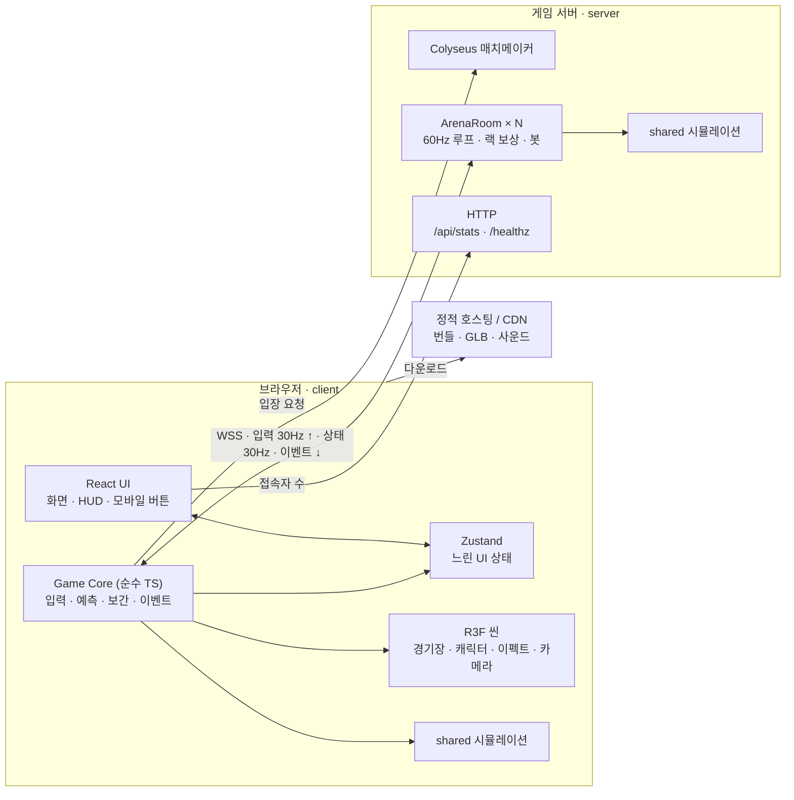
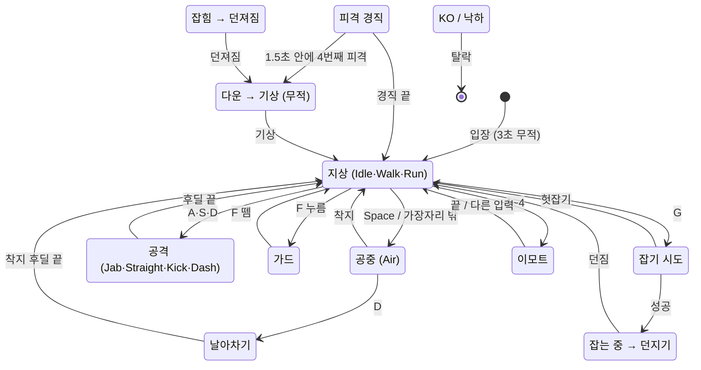
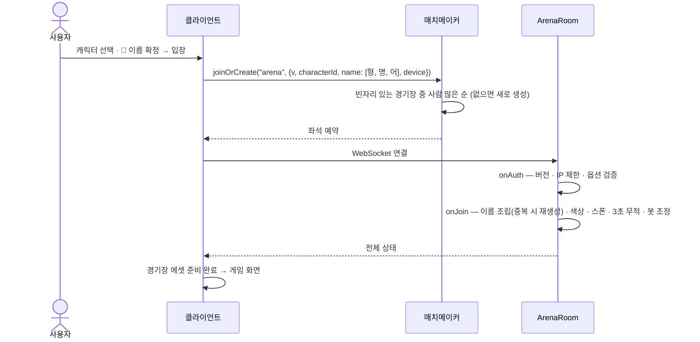
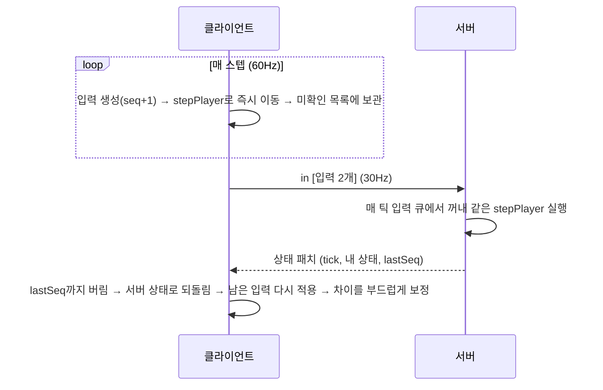
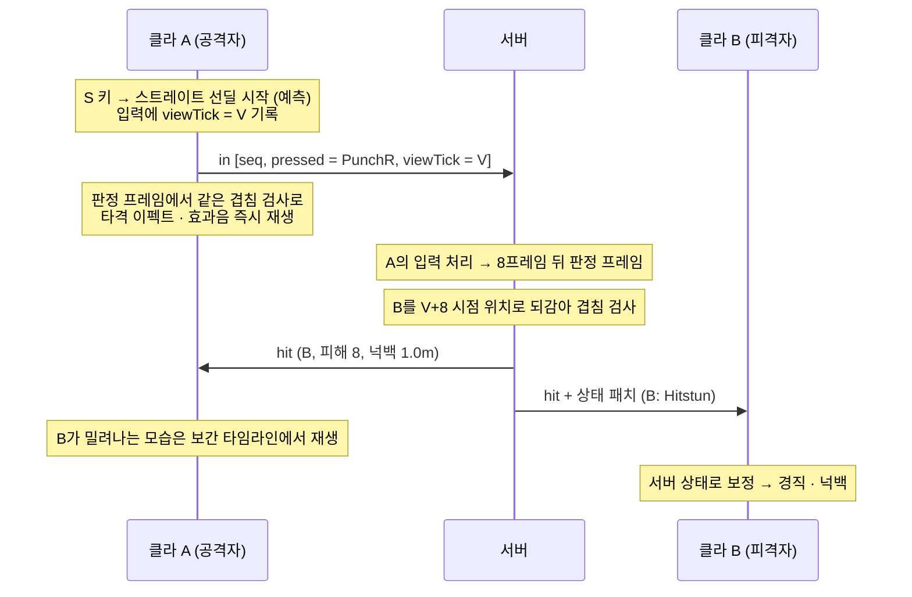
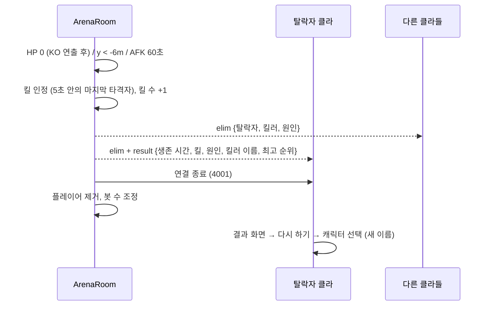
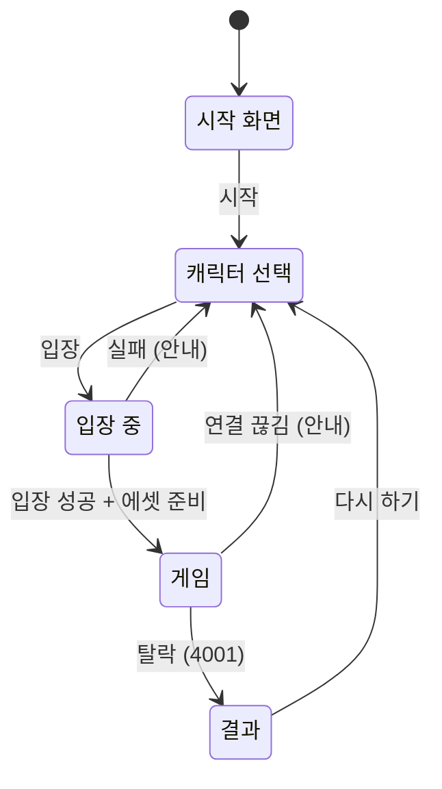
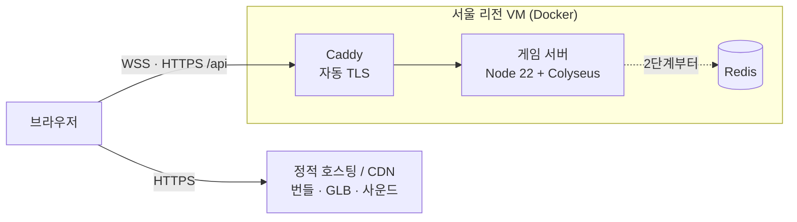

# 🥊 Fight Club (가칭) — 시스템 설계서

> `/sc:design` 결과 · 작성일 2026-10-30 · 상태: 초안 v0.1 (승인 대기)
> 근거: [requirements.md](requirements.md) (FR-01~56, NFR-01~12)
> 다음 단계: 승인 → `/sc:workflow` (구현 계획) → `/sc:implement`

---

## 0. 요약

- **구성**: 브라우저 클라이언트(Vite + React 19 + React Three Fiber) ↔ WebSocket ↔ 게임 서버(Node.js + Colyseus). 양쪽이 같은 `shared` 시뮬레이션 코드를 쓴다.
- **권위**: 위치·명중·HP·탈락은 모두 서버가 정한다. 클라이언트는 입력만 보낸다.
- **넷코드**: 내 캐릭터는 즉시 움직이고(예측) 서버 결과로 조용히 맞춘다(보정). 다른 캐릭터는 100ms 늦게 부드럽게 보여준다(보간). 근접 공격은 서버가 공격자 화면 시점으로 되감아 판정한다(랙 보상, 최대 300ms).
- **물리**: 바닥이 평평하므로 물리 엔진 없이 자체 운동학을 60Hz 고정 스텝으로 계산한다.
- **저장**: DB 없음. 경기장 상태는 서버 메모리에만 있다.
- **배포**: 클라이언트는 정적 호스팅/CDN, 서버는 서울 리전 VM 1대(Docker)에서 시작해 Redis로 수평 확장한다.

---

## 1. 설계 입력

### 1.1 현재 저장소와 제약

| 항목 | 현재 | 설계 반영 |
|---|---|---|
| 프론트엔드 | Vite 8 + React 19 + TypeScript 7 템플릿 | 유지하고 `client/`로 이동 |
| TS 설정 | `erasableSyntaxOnly`, `verbatimModuleSyntax` | shared·server에도 적용 → `enum` 대신 `as const` 객체 |
| 런타임·도구 | Node 22.17, npm 11 (pnpm 없음), Docker 27 | npm workspaces, 서버는 Docker로 배포 |
| 의존성 | 미설치 (node_modules·lockfile 없음) | 구현 첫 단계에서 설치 |
| 이름 | package.json `claw-machine`, index.html `lang="en"` | `fight-club`, `lang="ko"`로 정리 (§12) |

### 1.2 열린 질문에 대한 설계 기본값

요구사항 §11의 열린 질문은 아래 값으로 설계했다. 대부분 바뀌어도 상수만 고치면 된다.

| # | 질문 | 설계 기본값 | 바뀌면 |
|---|---|---|---|
| 1 | 서비스 이름 | Fight Club (가칭) | 문구만 |
| 2 | 경기장 테마 | 하늘에 떠 있는 정사각형 돌 경기장, 장애물 없음 | 장애물이 생기면 충돌 처리 확장 (§4.3) |
| 3 | 키 배정 | 가드 F · 잡기 G · 이모트 1~4 | 상수만 |
| 4 | 봇 | 사람이 1~3명이면 4명까지 채움, 봇 킬도 킬 수에 포함 | 상수만 |
| 5 | 이모트 | 손 흔들기 · 도발 · 춤 · 승리 포즈 | 에셋만 |
| 6 | 동시 접속·예산 | 1단계 목표 동시 접속 약 200명 (경기장 12개), 서버 1대 | 확장 단계 시점 (§8.2) |
| 7 | 기술 스택 | 기존 템플릿 유지 + R3F + Colyseus | 설계 전반 |
| 8 | 잡기 탈출 | 없음 | 상태 머신 |
| 9 | 킬 시 HP 회복 | 없음 | 상수만 |

---

## 2. 핵심 설계 결정

| ID | 결정 | 검토한 대안 | 이유 |
|---|---|---|---|
| ADR-01 | 3D 렌더링: **three.js + React Three Fiber v9 + drei** | three.js 직접 사용, Babylon.js | 기존 React 19 템플릿과 바로 맞물리고, UI는 React DOM으로 만들기 쉽다. 매 프레임 바뀌는 값은 React state 대신 ref로 다뤄 성능을 지킨다 |
| ADR-02 | 게임 서버: **Node.js + Colyseus** | `ws` 직접 구현, Socket.IO, WebRTC(geckos.io) | 경기장(방) 수명주기, 매치메이킹(사람 많은 방 우선 정렬), 상태 변경분 자동 동기화, 모니터, Redis 수평 확장을 기본 제공한다. TS라 클라이언트와 코드를 공유할 수 있다 |
| ADR-03 | **서버 권위** 판정 | 공격자 클라이언트 판정 + 서버 검증 | NFR-05: 클라이언트를 변조해 HP·위치·명중을 조작할 수 없어야 한다 |
| ADR-04 | 넷코드: **예측·보정 + 보간 + 랙 보상** | 보정 없이 서버 결과만 표시 | NFR-04(150ms에서도 즉각 반응)와 R1(근접 판정 체감)을 함께 해결 |
| ADR-05 | 물리: **자체 운동학 (공유 TS 코드)** | Rapier(WASM), cannon-es | 평평한 바닥과 원기둥 캐릭터만 다루면 된다. 같은 코드가 브라우저와 Node에서 같은 결과를 내도록 만들기 쉽다 |
| ADR-06 | **npm workspaces 모노레포**: `client`·`server`·`shared` | 저장소 분리, pnpm·turborepo | 시뮬레이션과 프로토콜 타입을 한 곳에서 공유한다. 이미 설치된 npm으로 충분하다 |
| ADR-07 | **DB 없음** (메모리 상태) | Redis, PostgreSQL | 로그인과 누적 기록이 MVP 범위 밖이다. 누적 랭킹을 도입할 때 추가한다 |
| ADR-08 | 전송: **WebSocket(WSS) 연결 하나** | WebTransport, WebRTC | 모든 대상 브라우저가 지원하고, 상태와 이벤트의 순서가 보장된다. 패킷 손실은 보간 버퍼로 흡수한다 |
| ADR-09 | UI 상태: **Zustand** | Redux, React Context | React 밖의 게임 루프에서도 쓰기 쉽고 가볍다 |
| ADR-10 | 배포: **정적 호스팅 + 서울 리전 VM(Docker)** | PaaS, 매니지드 게임 서버 | 국내 사용자 지연이 가장 작고(NFR-04) 비용을 예측하기 쉽다 |

---

## 3. 시스템 구성

### 3.1 구성도



### 3.2 저장소 구조

```
fight-club/
├─ package.json             # npm workspaces: client, server, shared
├─ eslint.config.js         # 공용 린트 설정
├─ docs/                    # requirements.md, design.md
├─ shared/                  # @fight-club/shared — 순수 TS, 클라이언트·서버 공용
│  └─ src/
│     ├─ constants.ts       # 틱, 경기장 크기, 속도, 시간 값
│     ├─ actions.ts         # Action 상수, 버튼 비트
│     ├─ attacks.ts         # 공격 프레임 데이터 표
│     ├─ sim/               # stepPlayer, 이동·낙하, 판정 도형, 넉백 계산
│     ├─ protocol.ts        # 메시지·입장 옵션·종료 코드·프로토콜 버전
│     ├─ quantize.ts        # mm 단위 양자화
│     └─ names/             # 단어 목록, 조사 처리, 이름 조합
├─ server/                  # @fight-club/server — Node + Colyseus
│  ├─ Dockerfile
│  └─ src/
│     ├─ index.ts           # 서버 시작, HTTP 라우트, 모니터
│     ├─ rooms/ArenaRoom.ts
│     ├─ rooms/state.ts     # ArenaState·PlayerState 스키마
│     ├─ world/             # 틱 루프, 입력 큐, 위치 히스토리, 판정 처리, 스폰, 탈락
│     ├─ bots/              # 봇 수 관리, 봇 행동
│     └─ security/          # IP 제한, 입력 검증, 메시지 빈도 제한
└─ client/                  # @fight-club/client — 기존 Vite 템플릿을 옮겨 옴
   ├─ index.html
   ├─ public/assets/        # 압축된 GLB·사운드
   └─ src/
      ├─ main.tsx, App.tsx  # 화면 전환
      ├─ screens/           # Title, Select, Connecting, Game, Result
      ├─ hud/               # 이름표 레이어, HP, 킬 피드, 순위표, 이모트, 모바일 버튼
      ├─ scene/             # Canvas, Arena, Character, Effects, CameraRig
      ├─ game/              # Game Core: net, clock, input, predict, interp, events
      ├─ store/             # zustand
      └─ audio/
```

### 3.3 기술 스택

| 영역 | 선택 |
|---|---|
| 클라이언트 빌드 | Vite 8, React 19, TypeScript 6.0 (§14 변경 기록) |
| 3D | three.js, @react-three/fiber v9, @react-three/drei |
| UI 상태 | zustand |
| 네트워크 | Colyseus 서버와 Colyseus JS SDK (구현 시점의 최신 안정 버전) |
| 서버 실행 | 개발은 `tsx watch`, 배포는 esbuild 번들 → Node 22 LTS |
| 사운드 | Howler.js |
| 에셋 도구 | glTF/GLB, gltf-transform (Meshopt 압축, KTX2·WebP 텍스처) |
| 테스트 | Vitest, @colyseus/testing, @colyseus/loadtest, Playwright |
| 로그 | pino (JSON) |

---

## 4. 게임 시뮬레이션 (shared)

### 4.1 좌표계·단위·시간
- 단위는 m, m/s, 프레임(1/60초)이고 y가 위쪽이다.
- 경기장은 원점 중심 24m × 24m다 (가장자리 x, z = ±12m). 바닥 높이는 y = 0.
- 카메라가 +z 쪽에서 -z 방향을 내려다보므로 화면 기준 ↑ = -z, → = +x다 (§7.5).
- 시뮬레이션은 60Hz 고정 스텝(1틱 = 16.67ms)이고, 서버와 클라이언트가 같은 스텝 함수를 쓴다.

### 4.2 플레이어 동작 상태

| 분류 | Action | 비고 |
|---|---|---|
| 이동 | Idle, Walk, Run, Air | Air = 점프·낙하 중 |
| 공격 | Jab, Straight, Kick, Dash, FlyingKick | §4.4 프레임 데이터 |
| 방어 | Guard, GuardStun | |
| 잡기 | GrabTry, Holding, Throwing / Grabbed, Thrown | 앞의 셋은 잡는 쪽, 뒤의 둘은 잡힌 쪽 |
| 피격 | Hitstun, Knockdown, GetUp | |
| 기타 | Emote1~4, KO, Falling | KO와 Falling 뒤에는 탈락 |



피격 경직·잡힘·KO·낙하로 가는 전이는 거의 모든 상태에서 일어나므로 그림에서는 화살표를 생략했다. 공중에서 A·S를 누르면 지상 펀치와 같은 동작이 나간다.

### 4.3 이동·점프·충돌

| 값 | 초기값 |
|---|---|
| 걷기 / 달리기 속도 | 4.0 / 6.5 m/s |
| 가속·감속 | 40 m/s² (거의 즉시) |
| 점프 초속 / 중력 | 7.0 m/s / 20 m/s² → 높이 약 1.2m, 체공 0.7초 |
| 공중 조작 | 수평 속도를 유지하고, 입력 방향으로 10 m/s²씩 가속 (걷기 속도까지) |
| 캐릭터 몸통 | 원기둥, 반지름 0.4m, 높이 1.8m |
| 탈락 높이 | y < -6m (떨어지기 시작한 뒤 약 0.8초) |

- **착지**: 위에서 내려오며 y = 0을 지날 때 캐릭터 중심이 경기장 안(|x|, |z| ≤ 12)이면 착지한다. 중심이 밖으로 나가면 바닥이 없으므로 떨어진다. 이미 y < 0인 캐릭터는 다시 착지할 수 없다. 따라서 가장자리 밖으로 점프했더라도 바닥 높이보다 아래로 내려가기 전에 공중 조작으로 돌아오면 산다.
- **바라보는 방향**: 이동 입력 방향으로 즉시 돈다. 공중에서도 몸은 바로 돌지만, 이동 방향은 공중 조작으로 천천히 바뀐다. 공격·가드·잡기·경직 중에는 고정된다.
- **몸끼리 부딪힘**: 다른 몸을 통과할 수 없다. 움직이는 쪽이 맞닿은 자리에서 멈추고(비스듬히 부딪히면 옆으로 미끄러진다), 상대는 밀리지 않는다. 이 처리로는 경기장 밖으로 밀려나지 않으며, 바닥 아래로 떨어지는 몸과는 부딪히지 않는다. 클라이언트도 서버가 마지막으로 보낸 상대 위치로 같은 처리를 예측한다. 상대 좌표는 전송 정밀도(float32)로 읽어서, 서 있는 상대에게는 예측이 서버와 정확히 맞는다 (움직이는 상대에게는 작은 보정이 생길 수 있다).
- 장애물이 추가되면 이 절의 충돌 처리를 확장한다 (필요하면 Rapier 검토).

### 4.4 공격 프레임 데이터 (60Hz 프레임 기준, 플레이테스트로 조정)

| 동작 | 입력 | 선딜 | 판정 | 후딜 | 피해 | 전방 거리 | 판정 반경 | 넉백 | 피격 경직 |
|---|---|---|---|---|---|---|---|---|---|
| 잽 (Jab) | A | 5 | 3 | 10 | 5 | 0.9m | 0.35m | 0.4m | 12 |
| 스트레이트 (Straight) | S | 8 | 3 | 16 | 8 | 1.0m | 0.35m | 1.0m | 18 |
| 발차기 (Kick) | D | 14 | 4 | 22 | 12 | 1.3m | 0.45m | 2.5m | 30 |
| 돌진 공격 (Dash) | 달리는 중 A·S·D | 6 | 8 | 26 | 12 | 1.0m (2.0m 전진하며) | 0.5m | 2.5m | 30 |
| 날아차기 (FlyingKick) | 공중에서 D | 6 | 착지까지 (최대 30) | 착지 후 18 | 14 | 1.2m | 0.5m | 3.0m | 33 |
| 잡기 (Grab) | G | 6 | 3 | 헛잡기 24 | — | 0.8m | 0.4m | — | — |
| 던지기 (Throw) | 잡은 뒤 방향 | 10 | — | 12 | 10 | — | — | 5.0m | 42 → 다운 |

- 돌진 공격은 A·S·D 중 어느 키로든 같은 동작 1종이 나간다 (애니메이션 수 절감, R3).
- 돌진 공격은 선딜·판정(14프레임) 동안 일정한 속도로 2.0m를 내달리고, 판정이 끝나면 그 자리에 멈춘다. 후딜 동안 미끄러지지 않는다.
- 선입력: 후딜 마지막 6프레임 안에 누른 공격은 후딜이 끝나는 즉시 나간다.
- 같은 스텝에 여러 키가 눌리면 잡기 > 발차기 > 특수(S) > 기본(A) > 점프 순으로 하나만 처리한다. 쿨타임 중인 키는 없는 것으로 보고 다음 순서로 넘어간다.
- 공격 한 번은 같은 상대를 한 번만 맞히지만, 범위 안의 여러 명을 동시에 맞힐 수 있다.
- **쿨타임** (사용자 요청 2026-11-02): 발차기는 시작한 뒤 **3초(180프레임)**, 잡기는 시도한 뒤(헛잡아도) **5초(300프레임)** 동안 다시 쓸 수 없다. 날아차기는 발차기와 쿨타임을 같이 쓴다 (점프로 피할 수 없다). 달리며 D(돌진)는 발차기가 아니라 막지 않는다. 쿨타임 중에 누른 키는 선입력되지 않는다.
- **A는 기본, S는 특수** (사용자 요청 2026-11-03): 오른손(S)은 왼손(A)보다 피해가 크다(8 대 5). 대신 선딜·후딜이 길다. 수치를 조정해도 이 관계는 지킨다 (테스트로 확인).
  - 남은 쿨타임은 `PlayerState.kickCooldown`·`grabCooldown`(남은 프레임)으로 두고 클라이언트도 예측한다. 화면 아래 키 그림(D·G)에 남은 초가 표시된다.

### 4.5 판정 도형
- **피격 판정(허트박스)**: 몸통 원기둥 (반지름 0.4m, 높이 0~1.8m).
- **공격 판정(히트박스)**: 공격자 앞쪽 '전방 거리' 지점에 놓인 구. 반지름은 판정 반경이고, 높이는 펀치 1.3m · 발차기 0.9m다.
- **겹침 검사**: 구 중심과 원기둥 축 사이의 수평 거리가 두 반지름의 합 이하이고, 높이 범위가 겹치면 명중이다.
- **조준 보정 (FR-21)**: 공격 첫 프레임에, 바라보는 방향 ±45° 안에서 2.0m 이내에 있는 가장 가까운 상대 쪽으로 몸을 돌린다. 이 계산은 입력의 viewTick 시점 위치로 하므로 클라이언트 예측과 서버 결과가 같다 (§5.6).
  - 클라이언트는 입력하는 순간 화면에 그려진 상대 위치로 계산하고, 보정 때문에 입력을 다시 적용(replay)할 때도 그때 값을 그대로 쓴다 (`ctx.memo`). 서버는 그 입력이 보던 시점으로 되감은 위치로 계산한다. 맞을 수 없는 상대(무적·다운·KO·낙하)는 대상에서 뺀다.
- **가드 방향**: 막는 쪽이 바라보는 방향과 공격자 쪽 방향 사이의 각도가 70° 이내(앞쪽 140°)이면 정면 공격으로 본다.

### 4.6 넉백·경직·다운
- 넉백은 공격별 고정 거리 d다 (D6). 초기 수평 속도 v0 = √(2·a·d)로 출발해 a = 20 m/s²로 감속하며 미끄러진다. 방향은 공격자에서 피격자 쪽이고, 던지기만 고른 방향이다.

  | 넉백 거리 | 0.4m | 1.0m | 2.5m | 3.0m | 5.0m |
  |---|---|---|---|---|---|
  | 초속 · 미끄러지는 시간 | 4.0 m/s · 0.2초 | 6.3 · 0.32초 | 10.0 · 0.5초 | 11.0 · 0.55초 | 14.1 · 0.71초 |

- **가드 성공**: 피해 ×0.2 (반올림, 최소 1), 넉백 ×0.3, 가드 경직 8프레임.
- **무한 경직 방지 (FR-32)**: 마지막 피격 후 90프레임(1.5초) 안에 다시 맞으면 연속 피격 수가 1 늘어난다. 4번째 피격은 경직 대신 다운(48프레임)을 일으키고, 일어나며 60프레임 동안 무적이 된다. 다운 중에도 무적이다.
- **히트스톱**(타격 순간의 짧은 멈춤)은 화면 연출만 한다. 시뮬레이션은 멈추지 않으므로 네트워크 동기화가 단순해진다.
- 던지기(엎어치기)의 업기·어깨 너머 넘기기도 화면 연출이다 (§4.7). 시뮬레이션에서는 잡힌 쪽이 잡는 쪽 앞에 붙어 있다가 수평으로 미끄러진다.

### 4.7 잡기·던지기
- **잡기 시도 (G)**: 선딜 6프레임 뒤 판정 3프레임. 대상은 지상에 있어야 하고, 무적·다운·KO·잡힘·잡는 중 상태가 아니어야 한다. 가드는 무시한다.
- **성공**: 잡는 쪽은 Holding이 되어 제자리에 서고, 잡힌 쪽은 Grabbed가 되어 잡는 쪽 앞 0.8m(몸이 맞닿는 거리)에 붙는다. 더 가까이 붙이면 몸끼리 부딪힘(§4.3)과 다툰다. 잡힌 쪽은 경기장 안쪽에 둔다 — 떨어뜨리는 건 던지기의 몫이다.
- **던지기**: 방향 입력이 들어오면 즉시 그쪽으로 던진다. 잡기 전부터 누르고 있던 방향도 포함한다. 36프레임(0.6초) 동안 입력이 없으면 바라보는 방향으로 던진다. 던지는 동작 10프레임 뒤 피해 10, 넉백 5.0m를 주고, 잡혔던 쪽은 Thrown을 거쳐 다운된다.
- **연출 — 엎어치기** (사용자 요청 2026-11-03): 방향을 고르면 잡는 쪽이 그쪽으로 돌아서고, 잡힌 쪽은 놓을 때까지(10프레임) 잡는 쪽 둘레를 돌아 등 뒤에 업힌다. 놓인 뒤에는 잡는 쪽 머리 위(회전 중심 약 2.1m)를 넘어 앞으로 3/4바퀴 돌며 날아가, 던진 쪽으로 머리를 두고 등을 대고 떨어진다 (공중 30프레임). 잡는 쪽은 그동안 허리를 숙인다(최대 80°). 판정·피해·넉백 거리·방향은 바뀌지 않는다 — 화면에만 더하고, 날아가는 동안 화면 위치를 등 뒤 출발점에서 시뮬레이션 위치로 부드럽게 옮긴다(가장 빠를 때 약 20m/s, 떨어질 때는 시뮬레이션과 같은 빠르기).
- **끊김**: 잡는 쪽이든 잡힌 쪽이든 다른 사람에게 맞으면 잡기가 풀린다.
- 서로 동시에 잡으면 둘 다 헛잡기가 된다.
- 헛잡기 후딜 24프레임은 가드를 뚫는 강점에 대한 대가다.

### 4.8 상성·우선순위

| 상황 | 결과 |
|---|---|
| 공격 vs 정면 가드 | 가드 성공: 피해·넉백 감소 |
| 공격 vs 옆·뒤 가드 | 그대로 맞음 |
| 잡기 vs 가드 | 잡기 성공 |
| 공격 vs 잡기 선딜 | 공격 성공, 잡기 취소 |
| 같은 틱에 서로 명중 | 둘 다 맞음 (상쇄 없음) |
| 잡기 vs 잡기 (동시) | 둘 다 헛잡기 |
| 무적 상대 (입장·기상) | 맞지 않음. 무적인 쪽이 공격이나 잡기를 누르면 무적이 풀림 |

### 4.9 탈락·킬 인정

| 원인 | 조건 | 킬 |
|---|---|---|
| `ko` | HP 0 → KO 연출 60프레임 뒤 제거. KO 중에는 무적이지만, 마지막 타격의 넉백은 적용 | 마지막으로 피해를 준 사람 |
| `ringout` | y < -6m, 마지막으로 맞거나 던져진 지 300프레임(5초) 이내 | 마지막으로 때리거나 던진 사람 |
| `selfout` | y < -6m, 5초 안에 맞은 적 없음 | 없음 ("발을 헛디뎠습니다") |
| `afk` | 3600프레임(60초) 동안 의미 있는 입력(이동·버튼·이모트) 없음 | 없음 |
| 연결 끊김 | WebSocket 종료 | 없음, 즉시 제거 (FR-38) |

위치가 |x| 또는 |z| > 30m에 이르면 곧바로 ringout 또는 selfout으로 처리한다 (양자화 범위 보호, §5.8).

### 4.10 결정성 규칙 — 예측이 서버와 맞기 위한 약속
- 스텝 함수는 순수 함수다. 같은 상태와 같은 입력이면 결과도 같다. 현재 시각과 난수는 쓰지 않는다.
- 사칙연산과 `Math.sqrt`만 쓴다. 이 둘은 어느 JS 엔진에서나 결과가 같다고 표준이 보장한다. `Math.sin`·`cos`·`pow`는 브라우저와 Node 사이에 미세한 차이가 날 수 있어 시뮬레이션에 쓰지 않는다. 방향은 단위 벡터로 다룬다.
- 모바일 조이스틱 같은 아날로그 입력은 보내기 전에 -127~127 정수로 양자화하고, 클라이언트도 양자화된 값으로 예측한다.
- 서버는 매 틱이 끝날 때 상태를 전송 해상도(mm, mm/s)로 양자화한다. 그러면 클라이언트가 서버 상태에서 입력을 다시 적용한 결과가 서버와 정확히 같아진다.

### 4.11 닉네임 생성기
- **구성**: `[형용사] [명사][어미구]`. 어미구는 조사 자리를 가진 템플릿이다.
  - 어미구 예: `{와/과} 함께 춤을`, `{은/는} 그림자 속에`, `의 기상`
  - 조립 예: "조용한" + "태양" + "과 함께 춤을" → **조용한 태양과 함께 춤을**
- **받침 판정**: 마지막 글자가 한글 음절이면 `(코드 − 0xAC00) % 28 ≠ 0`일 때 받침이 있다. 와/과, 은/는, 이/가, 을/를을 지원한다.
- **단어 수 목표**: 형용사 20 × 명사 24 × 어미구 16 = 7,680 조합 (FR-13 기준인 1,000개 이상).
- **전송**: 클라이언트는 인덱스 3개로 미리보기를 만들고, 입장할 때 **인덱스만** 보낸다. 서버가 범위를 검증한 뒤 문자열을 조립하므로 클라이언트가 임의의 문자열을 넣을 수 없다.
- **중복**: 같은 경기장에 같은 이름이 있으면 서버가 어미구, 명사 순서로 다시 뽑는다 (최대 10회).
- 화면에 나오는 기능 명칭("인디언식 이름" 등)은 문구 상수로 분리해 쉽게 바꿀 수 있게 한다 (R6).

### 4.12 shared 모듈 인터페이스

```ts
// shared/src/sim — 클라이언트 예측과 서버가 같은 코드를 호출한다 (시그니처만 정의)
export interface PlayerSim {
  x: number; y: number; z: number      // m
  vx: number; vy: number; vz: number   // m/s
  fx: number; fz: number               // 바라보는 방향 (단위 벡터)
  action: ActionId                     // actions.ts의 as const 객체 값
  actionFrame: number                  // 현재 동작의 경과 프레임
  buffered: number                     // 선입력된 공격 (0 = 없음)
}

export interface StepEnv {
  /** 조준 보정용 상대 위치. 클라이언트는 보간 위치, 서버는 viewTick 시점으로 되감은 위치 */
  enemiesAt(viewTick: number): ReadonlyArray<{ id: string; x: number; z: number }>
}

/** 이번 스텝에 판정 프레임이 시작되면 반환되는 질의. 서버가 판정한다 */
export interface HitQuery {
  kind: 'attack' | 'grab'
  attack: AttackId
  sphere: { x: number; y: number; z: number; r: number }
  viewTick: number
}

/** 순수 함수: 같은 상태 + 같은 입력 + 같은 env → 같은 결과 */
export declare function stepPlayer(p: PlayerSim, input: InputFrame, env: StepEnv): HitQuery | null
```

---

## 5. 네트워크

### 5.1 누가 무엇을 정하나

| 항목 | 결정 주체 | 클라이언트 표시 |
|---|---|---|
| 내 이동·점프·동작 시작 | 서버 (클라이언트가 예측) | 즉시 예측 → 서버 상태로 보정 |
| 다른 플레이어의 위치·동작 | 서버 | 100ms 늦춰 보간 |
| 명중·피해·HP·넉백 | 서버 (랙 보상) | 내 공격의 타격 이펙트만 즉시 예측, 수치는 서버 확정 후 |
| 가드·잡기 성공 | 서버 | 서버 결과대로 |
| 탈락·킬·순위 | 서버 | 이벤트와 상태로 |
| 닉네임 | 서버 (클라이언트는 미리보기) | 인덱스만 전송 |
| 연출 (히트스톱·카메라 흔들림·사운드) | 클라이언트 | 시뮬레이션에 영향 없음 |

### 5.2 타이밍 값

| 값 | 초기값 | 근거 |
|---|---|---|
| 시뮬레이션 틱 | 60Hz | 격투 프레임 데이터의 해상도 |
| 상태 전송 (패치) | 30Hz (2틱마다) | 부드러움과 대역폭의 균형. 가능하면 루프에서 2틱마다 직접 보내 틱과 정확히 맞춘다 |
| 입력 전송 | 30Hz (스텝 2개씩 묶음) | 메시지 수 절반 |
| 보간 지연 | 기본 100ms, 지터에 따라 66~200ms 자동 조정 | 패치 3개만큼 여유 |
| 랙 보상 최대 되감기 | 300ms | 되감아야 하는 양 ≈ RTT + 보간 지연 → RTT 200ms까지 완전 보상 |
| 위치 히스토리 | 1초 (60틱) | 되감기 여유 |
| 핑 | 2초마다 | RTT 측정, 되감기 상한 계산 |

### 5.3 입장 흐름



### 5.4 내 캐릭터: 예측과 보정



- 다시 계산한 위치와 화면 위치의 차이가 2cm 미만이면 무시한다. 1m 미만이면 100ms에 걸쳐 부드럽게 맞추고, 그 이상(피격·잡힘)이면 바로 맞춘다.
- 피격·넉백·잡힘은 서버만 알기 때문에 내 화면에는 RTT만큼 늦게 나타난다. 이건 피할 수 없다.

### 5.5 다른 캐릭터: 보간
- 받은 패치를 틱 번호와 함께 버퍼에 쌓는다. 그리고 `렌더 틱 = 추정 서버 틱 − 보간 지연`을 끼고 있는 두 패치 사이를 선형 보간해 그린다.
- 추정 서버 틱은 패치 도착 시각과 틱 번호로 계산하고, 갑자기 튀지 않게 평활화한다.
- 다음 패치가 늦으면 최대 100ms까지 이어서 추정(외삽)하고, 그 뒤에는 멈춰 둔다.
- 애니메이션도 `action`과 `actionFrame`으로 맞춘다. 그래서 공격 동작이 모든 사람 화면에서 같은 프레임에 보인다.

### 5.6 근접 공격 판정: 랙 보상



- 모든 입력에는 viewTick이 붙는다. 입력하는 순간 화면에 그려진 원격 캐릭터가 서버 기준으로 몇 번째 틱인지를 나타낸다.
- 공격자의 판정 프레임이 시작되면, 서버는 다른 플레이어를 그 입력의 viewTick 시점 위치로 되감아 겹침을 검사한다. 틱 사이 위치는 히스토리를 선형 보간해 구한다.
- 되감기 상한은 `min(300ms, 측정 RTT + 보간 지연 + 50ms)`다. 그래서 viewTick을 속여 먼 과거로 되감을 수 없다.
- 피해와 넉백은 현재 상태에 적용한다.
- 가드는 되감은 시점과 현재 시점 중 한 번이라도 정면 가드 중이었으면 가드로 처리한다 (방어자 우대).
- 무적 여부는 현재 상태로 판단한다.
- 봇의 공격은 되감지 않는다 (viewTick = 현재 틱).
- 내 공격의 타격 이펙트와 효과음은 클라이언트가 같은 겹침 검사로 즉시 재생한다. 랙 보상 덕분에 대부분 서버 결과와 일치한다. HP와 넉백은 서버가 확정한 뒤 반영한다.
- **남는 한계**: 피격자 화면에서는 주먹이 닿기 직전에 맞은 것처럼 보일 수 있다. 되감기 상한과 선딜(상대가 휘두르는 모습이 먼저 보임)로 이 차이를 줄인다.

### 5.7 탈락 흐름



### 5.8 상태·메시지 정의

**동기화 상태** (Colyseus Schema, 서버 → 모든 클라이언트, 바뀐 필드만 30Hz로 전송)

| 필드 | 타입 | 바뀌는 빈도 | 설명 |
|---|---|---|---|
| `ArenaState.tick` | uint32 | 매 틱 | 서버 틱 (보간·랙 보상의 기준) |
| `ArenaState.arenaNo` | uint16 | 생성 시 | 경기장 번호 |
| `ArenaState.players` | Map<string, PlayerState> | 입·퇴장 | 키는 sessionId, 봇은 `bot:번호` |
| `name` | string | 입장 시 | 서버가 조립한 이름 |
| `characterId` · `color` | uint8 | 입장 시 | 캐릭터, 색상 변형 |
| `isBot` | boolean | 입장 시 | 🤖 표시 |
| `joinedAt` | float64 | 입장 시 | 서버 시각(ms). 생존 시간과 순위 동점 처리에 사용 |
| `kills` · `hp` | uint16 · uint8 | 가끔 | 킬 수, HP (0~100) |
| `x` · `y` · `z` | int16 | 움직일 때 매 틱 | 위치 (mm, ±32.7m) |
| `vx` · `vy` · `vz` | int16 | 자주 | 속도 (mm/s) |
| `fx` · `fz` | int8 | 자주 | 바라보는 방향 (×127) |
| `action` · `actionFrame` | uint8 · uint16 | 자주 · 매 틱 | 동작, 경과 프레임 |
| `buffered` · `flags` | uint8 · uint8 | 가끔 | 선입력, 비트 1 = 무적 |
| `lastSeq` | uint32 | 30Hz | 서버가 처리한 이 플레이어의 마지막 입력 번호 |

Schema는 데코레이터나 클래스 없이 `schema({...})` + `t.*` 필드 빌더로 정의한다. Schema v5가 권장하는 방식이고(`defineTypes`는 deprecated), `erasableSyntaxOnly` 규칙과도 충돌하지 않는다 (S4에서 확인).

**메시지**

| 이름 | 방향 | 내용 | 빈도 |
|---|---|---|---|
| `in` | C → S | `InputFrame[]` (최대 8개) | 30Hz |
| `ping` | C → S | `{ clientTime }` | 2초마다 |
| `pong` | S → C | `PongMsg` | 응답 |
| `hit` | S → 모두 | `HitEvent` | 명중 시 |
| `elim` | S → 모두 | `ElimEvent` | 탈락 시 |
| `result` | S → 본인 | `ResultMsg` (직후 4001로 연결 종료) | 탈락 시 |

```ts
// shared/src/protocol.ts — 인터페이스 정의
export const PROTOCOL_VERSION = 1

export const Btn = {
  PunchL: 1 << 0, // A
  PunchR: 1 << 1, // S
  Kick:   1 << 2, // D
  Jump:   1 << 3, // Space
  Run:    1 << 4, // Shift (누르는 동안)
  Guard:  1 << 5, // F (누르는 동안)
  Grab:   1 << 6, // G
} as const

/** 60Hz 스텝마다 하나. 클라이언트가 2개씩 묶어 'in'으로 보낸다 (전송 시 배열로 압축) */
export interface InputFrame {
  seq: number       // 1씩 증가
  mx: number        // -127..127, 화면 기준 → 가 +
  mz: number        // -127..127, 화면 기준 ↓ 가 + (↑ = -z)
  held: number      // 누르고 있는 버튼 비트 (Run, Guard)
  pressed: number   // 이번 스텝에 새로 눌린 버튼 비트 (공격, 점프, 잡기)
  emote: number     // 0 = 없음, 1..4
  viewTick: number  // 이 입력 순간 화면에 그려진 원격 캐릭터의 서버 틱 (소수 허용)
}

export interface JoinOptions {
  v: number                                          // PROTOCOL_VERSION
  characterId: number                                // 0..CHARACTER_COUNT-1
  name: [adj: number, noun: number, suffix: number]  // 단어 목록 인덱스
  device: 'pc' | 'mobile'
}

export type AttackId = 'jab' | 'straight' | 'kick' | 'dash' | 'flyingKick' | 'throw'
export type ElimCause = 'ko' | 'ringout' | 'selfout' | 'afk'

export interface HitEvent  { tick: number; attacker: string; victim: string; attack: AttackId; guarded: boolean; damage: number }
export interface ElimEvent { tick: number; victim: string; victimName: string; killer?: string; killerName?: string; cause: ElimCause }
export interface ResultMsg { survivalMs: number; kills: number; cause: ElimCause; killerName?: string; bestRank: number }
export interface PongMsg   { clientTime: number; tick: number }

export const CloseCode = {
  Eliminated: 4001,      // 탈락 → 결과 화면
  VersionMismatch: 4002, // 새로고침 안내
  RateLimited: 4003,     // 접속 제한
  InvalidInput: 4004,    // 비정상 메시지
} as const
```

### 5.9 대역폭 추정
- **내려받기**: 움직이는 플레이어 1명은 패치 한 번에 약 15~25B(바뀐 필드만)를 차지한다. 16명 × 30Hz면 약 7~12KB/s.
- **올려보내기**: 입력 묶음 약 30B × 30Hz ≈ 1KB/s.
- **서버 송신**: 꽉 찬 경기장 1개 ≈ 16명 × 12KB/s ≈ 200KB/s (약 1.5Mbps). 플레이어 1명이 1시간 플레이하면 약 30~50MB다.

---

## 6. 서버

### 6.1 매치메이킹·경기장 수명주기
- `define('arena', ArenaRoom).sortBy({ clients: -1 })`, `maxClients = 16`, `joinOrCreate`를 조합한다. 빈자리가 있는 경기장 중 사람이 가장 많은 곳에 배정하고, 모두 차 있으면 새 경기장을 만든다 (FR-03·04).
- 봇은 클라이언트가 아니므로 정원 16명에 들어가지 않는다. 봇은 사람이 3명 이하일 때만 있으므로 총원이 넘칠 일은 없다.
- 경기장 번호는 사용 중이 아닌 가장 작은 번호(#1, #2 …)를 준다. 1단계는 프로세스 메모리에서, 확장 후에는 Redis에서 관리한다.
- 마지막 사람이 나가면 경기장을 닫는다.

| 단계 | 처리 |
|---|---|
| `onCreate` | 경기장 번호 배정, 60Hz 루프 시작, 패치 30Hz 설정 |
| `onAuth` | 프로토콜 버전, IP별 동시 접속·입장 빈도 제한, Origin, 옵션 형식 검증 |
| `onJoin` | 이름 조립·중복 처리, 색상 배정, 스폰, 3초 무적, 봇 수 조정 |
| `onMessage('in')` | 형식 검증 → 입력 큐에 추가 |
| `onMessage('ping')` | `pong` 응답, RTT 기록 |
| `onLeave` | 즉시 제거 (FR-38), 봇 수 조정 |
| `onDispose` | 경기장 번호 반납 |

### 6.2 틱 처리 순서 (60Hz 고정 스텝)
1. **입력 적용**: 사람은 입력 큐(§6.3), 봇은 봇 행동(§6.5)에서 입력을 받아 `stepPlayer`를 실행하고 판정 질의를 모은다.
2. **판정 처리**: 모은 질의를 랙 보상으로 검사해 피해·넉백·가드·잡기를 적용하고 `hit` 이벤트를 보낸다. 질의를 모두 모은 뒤 한꺼번에 처리하므로 처리 순서가 결과에 영향을 주지 않는다 (서로 명중 = 둘 다 맞음).
3. **물리 마무리**: 몸 밀어내기, 착지, 낙하.
4. **탈락 검사**: KO 연출 종료, y < -6m, AFK → 킬 인정, `elim`·`result` 전송, 제거.
5. **정리**: 봇 수 조정, 순위 계산(1초마다), 위치 히스토리 기록, 상태 양자화, tick + 1.

타이머 오차를 흡수하기 위해 경과 시간을 누적하고, 콜백 한 번에 고정 스텝을 0~2번 실행한다.

### 6.3 입력 큐와 속도 조작 방지
- 플레이어마다 입력 큐가 있고, 틱마다 1개씩 처리한다. 2개 넘게 밀려 있으면 그 틱에 2개를 처리해 따라잡는다.
- 큐가 10개(약 166ms)를 넘으면 오래된 입력부터 버리되 seq는 처리한 것으로 기록한다. 입력을 빨리 보내도 캐릭터는 빨라지지 않는다.
- 6틱(100ms) 동안 입력이 없으면 서버가 빈 입력으로 진행한다. 입력을 끊어서 공중에 멈추는 악용을 막기 위해서다.
- 메시지 검증: 배열 길이 8 이하, 값 범위(mx·mz ±127, 정의된 버튼 비트, emote 0~4), seq 증가. 위반하면 4004로 연결을 끊는다.

### 6.4 스폰
- 안쪽 영역(|x|, |z| ≤ 8m)에서 후보 12곳을 뽑고, 다른 플레이어와의 최소 거리가 가장 큰 곳에 세운다 (FR-17). 3초 동안 무적이다 (FR-18).

### 6.5 봇
- **수 조정**: 사람이 1~3명이면 모두 4명이 되도록 봇을 넣고, 사람이 들어오면 가장 최근에 넣은 봇부터 뺀다. 봇이 탈락하면 3초 뒤 새 이름의 봇으로 다시 채운다.
- **행동**: 단순한 상태 머신이 입력을 만들어 사람과 같은 입력 파이프라인에 넣는다.

  | 상태 | 행동 |
  |---|---|
  | 배회 | 안쪽 영역의 임의 지점으로 걸어감 |
  | 추격 | 8m 안의 가장 가까운 상대(사람 우선)에게 다가감 |
  | 공격 | 1.2m 안에 들어오면 250~450ms 반응 지연 뒤 잽 50% · 스트레이트 30% · 발차기 20% |
  | 방어 | 근처 상대가 선딜 중이면 30% 확률로 0.5초 가드. 상대가 가드 중이면 20% 확률로 잡기 |
  | 복귀 | 가장자리 2m 안이면 중앙 쪽으로 이동 (스스로 떨어지지 않음) |

- **이름**: 같은 생성기를 쓰고 `isBot`으로 🤖를 표시한다.

### 6.6 이름·색상 배정
- 이름은 §4.11의 규칙을 따른다.
- 색상은 같은 캐릭터를 고른 사람들 사이에서 가장 적게 쓰인 색상 변형(0~3)을 준다 (FR-08).

### 6.7 보안·남용 방지

| 위협 | 대응 |
|---|---|
| 클라이언트 변조 | 서버 권위, 서버는 입력만 받음 (NFR-05) |
| 속도 조작 | 입력 큐 상한과 초과분 버림 (§6.3) |
| 과거 시점 악용 | 되감기 상한 (§5.6) |
| 다중 접속 | 같은 IP 동시 접속 3개, 입장 요청 분당 10회로 제한 (NFR-06) |
| 비정상 메시지 | 형식·범위 검증, 초당 40개를 넘으면 연결 종료 |
| 다른 사이트에서 접속 | WebSocket Origin 허용 목록 |
| 이름 악용 | 인덱스만 받고 문자열은 서버가 조립 |
| 개인정보 | IP는 제한 계산에만 메모리로 쓰고 저장하거나 로그에 남기지 않음 (NFR-10) |
| 관리 화면 | 모니터는 Basic 인증 + 환경 변수 비밀번호 |

입장 옵션의 `v`가 서버 버전과 다르면 4002로 거절하고, 클라이언트는 "새 버전이 있습니다. 새로고침해 주세요"를 띄운다.

### 6.8 HTTP API

| 메서드·경로 | 응답 | 용도 |
|---|---|---|
| `GET /api/stats` | `{ online: number, arenas: number }` (5초 캐시) | 시작 화면 접속자 수 (FR-02), 운영 (NFR-12) |
| `GET /healthz` | `200 ok` | 헬스 체크 |
| `/admin` | Colyseus 모니터 (인증 필요) | 운영 |
| `/matchmake/*` | Colyseus 기본 제공 | 입장 |

환경 변수: `PORT`, `ALLOWED_ORIGINS`, `ADMIN_PASSWORD`, `LOG_LEVEL`, 확장 시 `REDIS_URL`.

---

## 7. 클라이언트

### 7.1 화면 흐름



시작 → 입장 두 번의 클릭으로 경기장에 들어간다 (NFR-09의 3번 이내 충족).

### 7.2 모듈 구조와 원칙
- **Game Core** (React 밖, 순수 TS): `net`(Colyseus 연결·핑), `clock`(서버 틱 추정), `input`(키보드·터치 → InputFrame), `predict`(예측·보정), `interp`(보간 버퍼), `events`(틱에 맞춘 이펙트 예약).
- **R3F 씬**: 매 프레임 Core의 값을 읽어 three 객체를 ref로 직접 갱신한다. React 다시 그리기는 일어나지 않는다.
- **React UI**: 화면과 HUD. Zustand에는 HP·킬·순위·킬 피드처럼 느리게 바뀌는 값만 넣고, 이벤트가 있을 때나 초당 최대 10번 갱신한다.

### 7.3 프레임 루프

```
매 렌더 프레임 (requestAnimationFrame / useFrame):
  누적 시간 += dt   (최대 250ms로 제한)
  누적 시간 ≥ 1/60 인 동안 반복:
      입력 샘플 (viewTick = 현재 렌더 틱) → 내 캐릭터 예측 스텝 → 전송 대기열에 추가
      누적 시간 -= 1/60
  입력이 2개 모이면 전송 (30Hz)
  원격 캐릭터 보간 → 위치·애니메이션 갱신
  렌더 틱에 도달한 예약 이벤트 재생
  카메라 추적
```

탭이 숨겨지면 루프가 멈춘다. 그동안 서버는 빈 입력으로 진행하고, 60초가 지나면 AFK로 처리한다. 탭이 돌아오면 대기열을 비우고 최신 서버 상태에 다시 맞춘다.

### 7.4 입력 처리
- **키보드**: `KeyboardEvent.code`로 판단한다 (KeyA·KeyS·KeyD·KeyF·KeyG·Digit1~4·Arrow*·ShiftLeft/Right·Space). 그래서 **한/영 상태와 상관없이 동작**한다. 한글 입력 상태에서 A를 누르면 `key`는 'ㅁ'이지만 `code`는 KeyA다.
- 방향키와 Space의 기본 동작(페이지 스크롤)을 막는다. 창이 포커스를 잃으면 모든 키를 뗀 것으로 처리해 키가 눌린 채로 남지 않게 한다.
- `pressed`(새로 눌림)는 keydown 이벤트를 기록해 다음 스텝에 반영한다. 스텝 사이에 눌렀다 뗀 짧은 입력도 놓치지 않는다.
- **터치**: 라이브러리 없이 Pointer Events로 직접 만든다.
  - 화면 왼쪽 절반 어디든 누르면 그 자리에 조이스틱이 생긴다. 90% 이상 기울이면 달린다.
  - 오른쪽에 버튼 7개(펀치L · 펀치R · 발차기 · 점프 · 가드 · 잡기 · 이모트)를 둔다.
  - 게임 영역에 `touch-action: none`을 걸어 확대와 스크롤을 막는다.

### 7.5 렌더링·카메라·애니메이션
- **카메라**: 원근 카메라, 화각 40°, 수평 회전 없음, 아래로 55°, 거리 약 16m. 내 캐릭터를 부드럽게 따라간다. 이 거리에서 가로 약 20m가 보이므로 가장자리를 놓치지 않는다 (FR-16).
- **경기장**: 바닥 + 밝은 색의 가장자리 띠 + 아래로 보이는 하늘·구름 배경. 낭떠러지가 한눈에 보인다 (FR-15).
- **캐릭터**: 공통 뼈대를 쓰는 스킨드 메시다. 애니메이션 클립은 모든 캐릭터가 공유하는 별도 GLB 1개에 담는다. (로스터·클립 대응: `claudedocs/assets_fight-club.md`)
  - 동작이 바뀌면 앞 클립과 섞는다(crossfade). 공격·잡기는 클립의 타격 시점이 판정 첫 프레임(`actionFrame`)에 오도록 재생 위치를 정한다 (선딜·후딜 구간은 최대 2배속). 던지기는 잡은 자세 그대로 척추·가슴 뼈를 숙인다.
- **표시 효과**: 무적이면 반투명하게 깜빡인다. 같은 캐릭터의 색상 변형은 옷 부위(아틀라스 칸)만 셰이더로 색을 바꿔 구분한다. 던져지면 엎어치기로 넘어간다 (§4.7, 화면 연출). 서버는 잡은 쪽·잡힌 쪽 짝을 보내지 않으므로, 잡힌 쪽 가까이에서 잡고 있는 사람을 상대로 본다. 원격 캐릭터의 동작 프레임은 패치마다 1프레임 안팎 튀므로 이 연출은 프레임을 제 속도로 진행하며 실제 프레임 쪽으로 부드럽게 당긴다.
- **이펙트**: 타격 스파크·가드 고리·먼지·KO 폭발은 고정 크기 입자 풀(풀마다 그리기 호출 1번)을 돌려쓴다. 강타(발차기·돌진·날아차기·던지기)에는 약 5프레임 히트스톱과, 내가 끼어 있으면 카메라 흔들림을 넣는다.

### 7.6 HUD

| 요소 | 구현 |
|---|---|
| 이름표·HP 바 | DOM 레이어 한 장 위의 요소 16개를 매 프레임 화면 좌표로 옮긴다 (transform만 변경). 한글은 시스템 글꼴을 쓰므로 3D 텍스트용 한글 글꼴(수 MB)을 받을 필요가 없다. 봇은 🤖 |
| 내 상태 | HP, 킬 수, 생존 시간 (왼쪽 위) |
| 경기장 정보 | `경기장 #3 · 12/16`, 핑 |
| 킬 피드 | 오른쪽 위, 최근 5개, 5초 뒤 사라짐, 원인별 문구 |
| 순위표 | 상위 5명 + 내 순위. 상태에서 직접 계산 (킬 내림차순, 같으면 입장 시각 오름차순) |
| 조작 안내 | 처음 입장할 때 표시하고, H 키(모바일은 ? 버튼)로 다시 연다. PC·모바일을 자동으로 구분 (FR-55) |
| 키 그림 (PC) | 화면 아래 왼쪽 A·S·D·F·G(기본·특수·발차기·가드·잡기), 오른쪽 방향키. 반투명 흰 키, 누르면 눌려 들어가며 주황색, 발차기·잡기 키에 쿨타임 남은 초 |
| 이모트 | PC는 1~4, 모바일은 이모트 버튼 → 4칸 중 선택 |

### 7.7 에셋·로딩 예산 (NFR-03)

| 묶음 | 예산 (압축 후) | 받는 시점 |
|---|---|---|
| JS 번들 | 1.2MB 이하 (gzip) | 시작 화면. 3D·네트워크 코드는 지연 로딩 |
| 캐릭터 4~6종 | 각 1.2MB 이하 | 시작 화면에서 미리 받기 시작 |
| 공용 애니메이션 | 2MB 이하 | 시작·캐릭터 선택 화면 |
| 경기장 | 1.5MB 이하 | 입장 중 (매치메이킹과 동시에) |
| 효과음 | 1.5MB 이하 | 입장 중 |
| **합계** | **약 13MB 이하** (목표 20MB 이하) | |

시작 화면은 3D 없이 바로 뜬다 (3초 목표).

### 7.8 품질 단계·호환성

| 항목 | PC | 모바일 |
|---|---|---|
| 해상도 배율 | 최대 2 | 최대 1.5 (프레임이 떨어지면 1까지 자동 하향) |
| 그림자 | 내 캐릭터만 실시간, 나머지는 원형 그림자 | 모두 원형 그림자 |
| 안티에일리어싱 | 켬 | 끔 |
| 파티클 | 기본 | 절반 |

- 자체 성능 모니터가 1초마다 프레임 속도를 재서 해상도 배율을 자동으로 낮추고(48fps 미만이면 −0.25), 넉넉해지면 천천히 되돌린다 (NFR-01·02). 주소에 `?quality=mobile|pc`를 붙이면 단계를 강제한다.
- 시작할 때 WebGL2 지원 여부를 확인하고, 지원하지 않으면 안내한다 (NFR-08). 모바일에서는 가로 화면을 안내한다 (FR-52).

### 7.9 사운드
- Howler.js로 효과음 스프라이트 1개를 재생한다. 소리는 빌드 때 합성한다 (`tools/assets/sfx.mjs`). 첫 클릭·터치·키 입력에서 오디오 잠금을 풀고, 음소거 설정(M)은 localStorage에 저장한다. 내 캐릭터에서 멀수록 작고 좌우로 나뉘어 들린다.

---

## 8. 배포·운영

### 8.1 배포 구성



- **클라이언트**: `vite build` 결과를 정적 호스팅/CDN에 올린다 (Cloudflare Pages, Vercel, Netlify 등의 무료 등급으로 충분).
- **서버**: Docker 이미지를 서울 리전 VM(2 vCPU / 2~4GB)에서 Caddy(자동 TLS, `wss://`) 뒤에 둔다.
- 서버 주소는 빌드 환경 변수 `VITE_GAME_SERVER_URL`로 넣는다.
- **배포 절차**: 새 입장을 막고 → 진행 중인 경기장에 "서버 점검" 안내를 보낸 뒤 → 재시작한다. 1단계에서는 짧은 중단을 허용한다.

### 8.2 확장 단계 (NFR-07)

| 단계 | 구성 | 목표 |
|---|---|---|
| 1 (MVP) | VM 1대, 프로세스 1개 | 동시 접속 약 200명 (부하 테스트로 확정) |
| 2 | 같은 VM에 CPU 코어 수만큼 프로세스 + Redis (Colyseus Presence·Driver) | 프로세스끼리 경기장 정보 공유 |
| 3 | VM 여러 대 + 로드 밸런서 | 트래픽 확장 |

경기장끼리 공유하는 게임 상태는 없다. 2·3단계를 설정 추가만으로 갈 수 있도록, 처음부터 경기장 번호와 IP 제한을 인터페이스 뒤에 숨겨 둔다 (메모리 구현 → Redis 구현으로 교체).

### 8.3 관측
- **로그** (pino JSON): 입장, 퇴장, 탈락 원인, 검증 실패, 오류. IP는 기록하지 않는다.
- **지표**: 동시 접속자, 경기장 수, 경기장별 틱 처리 시간(평균·p95, 1분마다 기록), 패치 크기.
- **경고 기준** (예시): 경기장 틱 처리 p95 > 4ms, 프로세스 CPU > 70%.

### 8.4 비용 감각 (예산 결정용)
- 정적 호스팅은 무료 등급, 서버는 소형 VM 1대로 시작한다.
- 플레이어 1명이 1시간 플레이할 때 서버 송신량은 약 30~50MB다. 클라우드는 보통 나가는 트래픽에 요금을 매기므로, 동시 접속이 늘면 트래픽 비용이 주된 변수가 된다.

---

## 9. 테스트 전략

| 대상 | 도구 | 핵심 검증 |
|---|---|---|
| shared 시뮬레이션 | Vitest | 같은 입력 열 → 같은 결과(결정성), 프레임 데이터, 넉백 거리(±1cm), 착지·낙하·탈락, 조준 보정, 조사 처리와 이름 조합 수 |
| 서버 경기장 | Vitest + @colyseus/testing | 사람 많은 경기장 우선 배정, 17번째 입장 시 새 경기장, 봇 수 조정, 킬 인정·결과 전송, 입력 검증과 속도 조작 차단 |
| 넷코드 | 개발용 지연·지터·손실 주입 + 클라이언트 2~4개 수동 플레이 | 150ms·300ms에서의 판정 체감, 보정 빈도 |
| 부하 | @colyseus/loadtest | 경기장 12개 × 16명에서 경기장 틱 처리 p95 < 1ms, CPU < 70% |
| E2E | Playwright | 시작 → 선택 → 입장 → 탈락 → 결과 → 다시 하기, 모바일 화면 크기 |
| 성능 | 실제 기기 측정 | PC 내장 그래픽 60fps, 중급 스마트폰 30fps |

---

## 10. 요구사항 추적표

| 요구사항 | 설계 위치 |
|---|---|
| FR-01~05 입장·배정 | §5.3, §6.1, §6.8 |
| FR-06~08 캐릭터 | §6.6, §7.5, §7.7 |
| FR-09~13 닉네임 | §4.11, §6.6 |
| FR-14~18 경기장·카메라·스폰 | §4.1, §4.3, §6.4, §7.5 |
| FR-19~23 조작 | §4.3, §4.5, §7.4, §7.6 |
| FR-24~33 전투 | §4.4~4.8, §5.6 |
| FR-34~40 탈락 | §4.9, §5.7 |
| FR-41~44 HUD | §7.6 |
| FR-45~48 봇 | §6.5 |
| FR-49~51 이모트 | §4.2, §5.8 (`emote` 입력 필드), §7.6. 채팅 채널은 없음 |
| FR-52~56 모바일 | §7.4, §7.6, §7.8 |
| NFR-01·02 성능 | §7.8, §9 |
| NFR-03 로딩 | §7.7 |
| NFR-04 반응성 | §5.2~5.6 |
| NFR-05 공정성 | §5.1, §5.6, §6.3 |
| NFR-06 남용 방지 | §6.7 |
| NFR-07 확장성 | §8.2 |
| NFR-08 호환성 | §7.8 |
| NFR-09 사용성 | §7.1 |
| NFR-10 개인정보 | §6.7, §8.3 |
| NFR-11 에셋 라이선스 | §11 S2 |
| NFR-12 운영 | §6.8, §8.3 |

---

## 11. 리스크 대응과 선행 검증 (스파이크)

| 스파이크 | 대상 | 내용 | 통과 기준 |
|---|---|---|---|
| S1 넷코드 | R1 | 상자 캐릭터 + 잽 1종 + 예측·보간·랙 보상. 지연 0 / 150 / 300ms 주입 | 150ms에서 "분명 맞았는데" 체감이 없고, 보정 튐이 눈에 띄지 않음 |
| S2 에셋 | R3, NFR-11 | 공통 뼈대 캐릭터 4~6종과 애니메이션 약 20종 확보, 라이선스 확인 (CC0 계열 우선) | 전부 확보, 용량 예산(§7.7) 충족 |
| S3 모바일 성능 | R4, NFR-02 | 스킨드 캐릭터 16개 + 이펙트를 중급 스마트폰에서 실행 | 30fps 이상 |
| S4 툴체인 | — | TS 7 + Vite 8 + Colyseus(Schema `defineTypes`, 클래스 필드 초기화가 Schema 접근자를 덮어쓰지 않는지) + tsx + npm workspaces | 빌드·실행·타입 검사 통과 |

- 진행 순서는 S4 → S1 → S2·S3 병행이다. S1이 기준을 통과하지 못하면 판정 방식을 다시 검토한다 (대안: 공격자 클라이언트 판정 + 서버 검증).
- 다른 리스크: R5 서버 비용 → §8.4 · R6 이름 표기 → 문구 상수 분리(§4.11) · R7 남용 → §6.7 · 패킷 손실 시 TCP 지연 급증 → 보간 버퍼 자동 조정, 이후 WebTransport 검토.

---

## 12. 기존 코드 변경 계획 (승인 필요)

1. 루트 `package.json`을 npm workspaces(`client`, `server`, `shared`)로 바꾸고 이름을 `fight-club`으로 고친다.
2. 현재 Vite 앱(`src/`, `public/`, `index.html`, `vite.config.ts`, `tsconfig.app.json`, `tsconfig.node.json`)을 `client/`로 옮긴다. ESLint 설정은 루트에 남겨 공용으로 쓴다.
3. `index.html`을 `lang="ko"`로 바꾸고 제목을 고친다.
4. 템플릿 예제(App 카운터, `hero.png`, `react.svg`, `vite.svg`, `App.css` 내용)를 지운다.
5. 기존 tsconfig 규칙(`erasableSyntaxOnly` 등)을 shared·server에도 적용한다.

---

## 13. 다음 단계
1. 이 설계를 검토하고 승인한다. 특히 §2 핵심 결정과 §12 변경 계획.
2. `/sc:workflow` — 스파이크(S4 → S1 → S2·S3)를 앞에 둔 구현 단계 계획을 세운다.
3. `/sc:implement` — 계획대로 구현한다.

---

## 14. 변경 기록

| 날짜 | 변경 | 이유 | 영향 |
|---|---|---|---|
| 2026-10-30 | TypeScript 7.0 → **6.0.3** | TS 7 패키지는 네이티브 컴파일러라 typescript-eslint가 쓰는 JS 컴파일러 API가 없다. 설치 단계에서 peer 충돌이 나고, 강제로 설치해도 린트가 실행 중에 실패한다 | typescript-eslint가 TS 7을 지원하면 다시 올린다 |
| 2026-10-30 | **Colyseus 0.18 · Schema v5 · 클라이언트 SDK `@colyseus/sdk`** 적용 | 구현 시점의 최신 안정 버전 | 서버는 `defineServer`·`defineRoom`으로 정의하고, Schema는 `schema()` + `t.*`로 정의한다 (§5.8) |
| 2026-10-30 | S4 결과: Room의 클래스 필드(`state = …`, `patchRate = …`)가 정상 동작함 | Colyseus가 `__init()`에서 클래스 필드로 생긴 인스턴스 속성을 접근자로 되돌린다 | 클래스 필드 선언 방식을 그대로 쓴다 |
| 2026-10-30 | **검토 필요**: Colyseus 0.18 내장 넷코드 기능 확인 — 고정 스텝 루프(`setFixedTimestep`), 입력 버퍼(`defineInput`), 랙 보상(`allowRewindState`), 클라이언트 예측·보정(SDK `Reconciler`·`SimReconciler`), 지연 주입(`simulateLatency`), 메시지 제한·검증(`maxMessagesPerSecond`·`validate`) | 이 설계서가 직접 구현하기로 한 부분과 겹친다 | P1 착수 전에 §5.4~5.6, §6.2·6.3·6.7의 직접 구현 범위를 다시 정한다 |
| 2026-10-30 | **넷코드를 Colyseus 0.18 내장 기능 위에 구현** — 서버는 `setFixedTimestep`·`defineInput`·`allowRewindState`, 클라이언트는 `room.input`·`Reconciler`·`Predict`(lerp 100ms) | 설계한 예측·보정·보간·랙 보상과 같은 방식이면서 직접 구현할 코드와 버그 위험이 크게 준다. 원격 보간 지연과 서버 되감기 시점도 프레임워크가 같은 값으로 묶어 준다 | §5.4~5.6, §6.2·6.3의 직접 구현 부분을 대체한다. 게임 규칙(입력 크레딧 8, 입력이 6틱 끊기면 빈 입력으로 진행, 명중은 모두 움직인 뒤 한꺼번에 적용)은 그대로 둔다 |
| 2026-10-30 | 입력·상태 Schema를 `shared`로 옮김 (`@colyseus/schema` 의존 추가) | 클라이언트의 입력 핸들과 예측이 서버와 같은 스키마 클래스를 써야 한다 | §3.2 |
| 2026-10-30 | 위치·속도·방향 필드를 int16(mm) 대신 **float32**로 전송 | SDK Reconciler가 전송 정밀도(float32)를 감안해 예측과 비교하므로 따로 양자화할 필요가 없다 | §4.10의 "서버가 매 틱 양자화"는 하지 않는다. §5.8 필드 타입 |
| 2026-10-30 | 개발용 지연 주입은 값을 바꾸면 모든 클라이언트가 다시 접속한다 | Colyseus는 수신 지연을 입장할 때 연결에 묶고, SDK 시계는 RTT가 4배 넘게 뛰면 새 표본을 버린다. 지터·손실 주입은 지원하지 않는다 | §9 넷코드 시험 방법 |
| 2026-10-30 | **리스크 추가**: SDK 시계는 RTT가 갑자기 4배 넘게 늘면 끝까지 반영하지 않는다 (`RTT_OUTLIER_X = 4`) | 실제 망에서도 지연이 크게 뛰면 입력의 렌더 시각이 어긋나 랙 보상 시점이 틀어질 수 있다 | P6·P7에서 대응을 검토한다 (예: 재접속 유도, 시계 재설정) |
| 2026-10-30 | **공중에서도 입력 방향으로 몸을 돌린다** (사용자 결정, B안) | 점프한 뒤 등 뒤의 상대를 칠 수 없는 답답함을 없앤다. 이동 관성(공중 가속 10 m/s²)은 그대로라 점프의 대가와 낙사 긴장감은 남는다 | §4.3. 날아차기(P2)도 공중에서 돌린 방향으로 나간다 |
| 2026-11-02 | **몸끼리 부딪힘**을 "서버만 서로 밀어냄"에서 "움직이는 쪽이 막힘 + 클라이언트도 예측"으로 바꿈 (사용자 요청: 다른 사람을 통과하지 못하게) | 서버만 처리하면 상대에게 붙어 걸을 때 내 화면이 계속 보정되어 떨린다. 막는 방식은 서 있는 상대 앞에서 예측과 서버가 정확히 일치한다 (브라우저 점검: 150ms에서도 보정 0cm) | §4.3. P2-6을 앞당겨 완료 |
| 2026-10-30 | 개발용 샌드백 추가 — 서 있는 것과 좌우로 왕복하는 것, 디버그 패널 버튼으로 세우고 치운다 | 혼자서도 잽 판정과 랙 보상(움직이는 상대)을 시험할 수 있어야 한다 | `PlayerState.isBot`을 P5보다 먼저 추가했다. 프로덕션에서는 샌드백 메시지를 받지 않는다 |
| 2026-10-30 | S1 자동 점검: RTT 170ms에서 움직이는 상대를 맞힌 4건이 모두 서버에서 확정됐다 (예측 보정 0cm). RTT 326ms에서는 4건 중 2건만 확정 | RTT + 보간 지연(약 430ms)이 최대 되감기 300ms를 넘는다 — 설계에서 예상한 한계 | CP1 체감 시험 뒤 `MAX_REWIND_MS` 조정 여부를 정한다 |
| 2026-11-02 | **P2 전투 완성** (상자 버전): 공격 5종·선입력·키 우선순위·조준 보정, 가드, 잡기·던지기, 경직·연속 피격 다운·기상 무적, 입장 무적·스폰 위치, 탈락(KO·ringout·selfout·AFK·30m 범위)과 킬 인정 | 요구사항의 전투 규칙 | §4.4~4.9. P1의 임시 부활(떨어지면 가운데로 돌아옴)은 없앴다. 개발용 샌드백만 탈락 대신 제자리로 돌아온다 |
| 2026-11-02 | `PlayerState`에 `stun`·`buffered`·`invuln`(남은 프레임)과 `kills`를 둠. 무적은 비트 플래그 대신 남은 프레임 수다 | 무적이 풀리는 시점까지 클라이언트가 예측해야 하고, 깜빡임 표시에도 쓴다 | §5.8 필드. `HitEvent`에 맞은 뒤 `hp`를 더했다. 이름·`bestRank`는 P4에서 `ElimEvent`·`ResultMsg`에 더한다 |
| 2026-11-02 | 잡힌 쪽을 붙이는 거리 0.7m → **0.8m** | 0.7m는 몸 지름(0.8m)보다 가까워 몸끼리 부딪힘이 둘을 밀어낸다 | §4.7 |
| 2026-11-02 | 돌진은 판정이 끝나면 **바로 멈춘다** | 후딜 동안 감속하며 미끄러지면 이동 거리가 설계값 2.0m를 넘는다 | §4.4 |
| 2026-11-02 | 내 공격의 스파크는 화면에 보이는 상대 동작으로 가드 여부까지 예측한다 (가드면 파랑) | 막혔는지를 바로 보여 준다. 서버는 지금 가드 중인지도 보므로 가드 판정이 예측보다 후할 수 있다 (방어자 우대, §5.6) | 브라우저 점검: 가드 스트레이트 피해 2·파란 스파크 예측 일치 |
| 2026-11-02 | 클라이언트는 `result`를 받으면 연결 종료(4001)를 기다리지 않고 바로 결과 화면으로 간다. 결과 화면의 "다시 입장"은 지금은 곧바로 다시 접속한다 | 결과가 오면 판은 끝났다. 캐릭터 선택·새 이름은 P4에서 붙인다 | §7.1 흐름은 P4에서 완성 |
| 2026-11-02 | **개발용 지연 주입 중에는 탈락자 연결 종료를 편도 지연 + 50ms 미룬다** | Colyseus의 지연 흉내는 보내는 메시지만 `setTimeout`으로 늦추고 `client.leave()`는 바로 닫는다. 그대로면 `result`가 종료 뒤에 나가 버려진다 (실제 망에서는 순서가 지켜진다) | `ArenaRoom.closeDelayMs`를 `app.ts`가 정한다. 통합 테스트로 고정 |
| 2026-11-02 | **캐릭터 5종 확정** (사용자 승인): KayKit Adventurers 1.0(CC0)을 레시피로 고친 전사·곰전사·삐에로·유도가·닌자. 무기 캐릭터는 무기 동작, 판정은 모두 같다 | P3-1 아트 승인 | 로스터·레시피는 `claudedocs/assets_fight-club.md`, `tools/assets/recipes.js` |
| 2026-11-02 | **에셋 파이프라인**: 헤드리스 Chrome에서 레시피를 적용해 굽고(머티리얼별로 메시를 합쳐 그리기 호출 감소), gltf-transform+meshopt로 압축. 애니메이션은 기본 자세와 같은 트랙을 지워 3.5MB → 337KB | 예산 §7.7, 승인한 모습을 그대로 재현 (픽셀 비교) | 캐릭터 133~172KB. `npm run assets:build` (Chrome 필요), `assets:check`로 예산 검사 |
| 2026-11-02 | **공격 애니메이션 동기화**: 굽기 때 클립의 타격 시점(끝점이 가장 멀리 뻗는 순간)을 재고, 판정 첫 프레임에 맞춰 재생 | 원격 캐릭터의 공격도 프레임 단위로 맞아야 한다 (P3-3 완료 기준) | §7.5. 브라우저 점검: 내 캐릭터·원격 모두 판정 첫 프레임에 타격 시점 |
| 2026-11-02 | **색상 변형**: 머티리얼 전체 색조 대신 옷 부위만 셰이더로 색 회전·곱하기. 부위·색은 캐릭터마다 (`variants`). 서버가 가장 적게 쓰인 변형을 배정 | 전체 색조는 피부·얼굴까지 물들어 어색하다 | §7.5, §6.6. `PlayerState.characterId`·`variant` 추가 |
| 2026-11-02 | 입장 옵션 `characterId` 추가 (없거나 범위 밖이면 무작위). 개발용 샌드백은 캐릭터를 차례로 바꾼다 | 선택 화면(P4) 전에 모든 캐릭터를 시험한다 | §5.3·§5.8 |
| 2026-11-02 | **경기장 테마는 기본안**(하늘에 떠 있는 돌 경기장, 장애물 없음): 돌 타일 바닥, 노랑·검정 경고 띠, 아래로 좁아지는 바위 밑동, 하늘·구름. 텍스처는 실행 중에 그린다 | 열린 질문 2는 기본안으로 진행 (바꾸려면 알려 주면 된다) | 경기장 다운로드 0바이트 |
| 2026-11-02 | 톤 매핑을 끄고(R3F `flat`) 조명을 승인 미리보기와 같은 값으로 | 승인한 캐릭터 색 그대로 보이게 | §7.5 |
| 2026-11-02 | **효과음은 빌드 때 합성** (10종, WAV 스프라이트 186KB), 재생은 Howler.js | 라이선스 확인이 필요 없고 다시 만들 수 있다. 녹음한 소리로 바꾸려면 WAV만 교체 | §7.9 |
| 2026-11-02 | 품질 단계 모니터를 drei 대신 자체 구현 | 의존성을 늘리지 않고 같은 동작 (1초 구간 fps로 해상도 배율 조절) | §7.8 |
| 2026-11-02 | **버그 수정**: `frameloop="never"`에서 `advance()`에 ms를 넘겨 useFrame의 delta가 ms 단위였다 → 초로 넘김 | P1부터 카메라가 부드럽게 따라가지 않고 즉시 붙었다. P3에서 시간에 기대는 애니메이션·이펙트가 깨지며 드러났다 | 카메라가 설계대로 부드럽게(약 0.17초) 따라간다 |
| 2026-11-02 | **발차기 3초·잡기 5초 쿨타임** (사용자 요청). 날아차기는 발차기와 쿨타임 공유, 달리며 D(돌진)는 제외 | 발차기(큰 넉백)·잡기(던지기 낙사)를 연달아 쓰지 못하게 | §4.4. `PlayerState`에 `kickCooldown`·`grabCooldown` (SIM 필드) |
| 2026-11-02 | **화면 아래 키 그림** (사용자 요청): 왼쪽 A·S·D·F·G(아이콘·이름), 오른쪽 방향키. 누르는 동안 눌린 모습, D·G에 쿨타임 표시. 터치 기기에서는 숨긴다 | 조작을 한눈에 보이게 | §7.6. HUD 글씨는 키 그림에 없는 Shift·Space·M·연계만 남겼다 |
| 2026-11-03 | **입장 요청** `{ v, characterId, name: [형, 명, 어] }`, `PROTOCOL_VERSION`이 다르면 `onAuth`에서 4002로 거절 | 이름 문자열은 서버가 인덱스로 조립 (§4.11) | §5.3·§6.7. `PlayerState`에 `name`·`joinTick`, `ArenaState`에 `arenaNo` |
| 2026-11-03 | `ElimEvent`에 `victimName`·`killerName`, `ResultMsg`에 `killerName`·`bestRank` | 탈락한 사람은 곧 상태에서 사라지므로 킬 피드·결과 화면에 이름을 함께 보낸다. 최고 순위는 킬·입장·퇴장 때 서버가 갱신 | §5.8 |
| 2026-11-03 | 순위는 킬 내림차순, 같으면 먼저 들어온(`joinTick`) 순. 봇(🤖)도 순위표에 든다 | FR-44 "같으면 생존 시간" = 먼저 들어온 사람 | §7.6 |
| 2026-11-03 | `/api/stats`의 `online`은 경기장에 들어온 사람(클라이언트) 수, 봇 제외. 어느 출처에서나 읽게 `Access-Control-Allow-Origin: *` | 공개 정보 | §6.8 |
| 2026-11-03 | 킬 피드는 조사 없이 아이콘으로: `A 👊 B`(KO) · `A 🌀 B 밖으로`(낙사) · `🍃 B 추락`(자멸) · `💤 B 자리 비움` | 긴 이름 뒤에 조사를 붙이면 어색하다 | §7.6 |
| 2026-11-03 | 지연 로딩: 시작 화면은 React·화면만(75KB gzip), three·R3F·캐릭터 로더·Colyseus는 따로 받는다. 시작 화면이 뜨면 뒤에서 미리 받는다 | NFR-03, P4-6 | 측정: LTE에서 시작 화면 0.27초·입장 2.1초 |
| 2026-11-03 | 개발용: 주소에 `?play`를 붙이면 시작·선택을 건너뛰고 바로 입장(`&character=번호`). 지연 주입이 바뀌면 새로고침 대신 같은 설정으로 다시 입장 | 자동 점검·개발 편의. 다시 입장은 새 Client로 연결하므로 SDK 시계도 새로 잰다 | 프로덕션에서는 쓰지 않는다 |
| 2026-11-03 | E2E는 `@playwright/test`로 설치된 Chrome을 쓰고, 전용 포트(서버 2767·클라이언트 5373)로 띄운다 | 브라우저를 따로 받지 않고, 개발 서버와 부딪히지 않게 | §9. `npm run test:e2e` (데스크톱·가로 휴대폰 크기) |
| 2026-11-03 | 개발용 디버그 패널을 왼쪽(내 상태 아래)으로 옮김 | 오른쪽 위는 킬 피드·순위표 | — |
| 2026-11-03 | **유도가의 A = 왼손 정권찌르기, S = 오른손 어퍼컷** (사용자 요청 — A가 오른손으로 때렸다) | 키 이름(왼손·오른손)과 실제로 때리는 손을 맞춘다. 원본에 왼손 펀치가 없어 오른손 정권을 굽기 단계에서 좌우로 뒤집어 만든다. S는 한때 정권찌르기로 바꿨다가 사용자 요청으로 다시 어퍼컷 | 무기 캐릭터의 A·S는 그대로 무기 동작 |
| 2026-11-03 | **A·S 이름을 왼손·오른손에서 기본·특수로**, 키 그림은 반투명 흰색 (사용자 요청) | 무기 캐릭터는 A·S를 모두 오른손 무기로 쳐서 '왼손·오른손'이 동작과 맞지 않았다. 특수(S)가 더 세고 느리다는 §4.4 규칙과도 맞는다 | §7.6 키 그림·조작법 안내·README. 누른 키는 그대로 주황색 |
| 2026-11-03 | **잡기 → 엎어치기 연출** (사용자 요청). 던지는 쪽은 잡은 자세로 허리를 숙이고, 잡힌 쪽은 등 뒤에 업혔다가 머리 위를 넘어 앞으로 3/4바퀴 돌아 등을 대고 떨어진다. 던지기 불꽃은 등 뒤에 | 판정·피해·넉백은 그대로 두고 화면만 바꾼다 (서버·프로토콜 변경 없음). 공중 시간은 24→30프레임 — 등 뒤에서 넘어간 뒤 시뮬레이션 위치를 따라잡는 빠르기를 줄인다 | §4.7, §7.5. 던지기 클립(Throw)은 쓰지 않아 애니메이션 파일에서 뺐다. 원격 화면에서는 잡힌 쪽이 잡혀 있는 동안 자리를 다시 잡지 않는다(던지는 순간 서버가 옮기는 것이 보이지 않게) |
